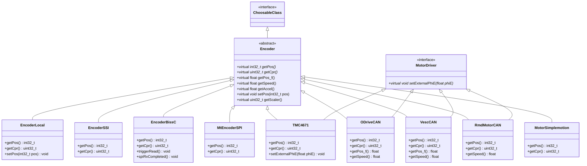
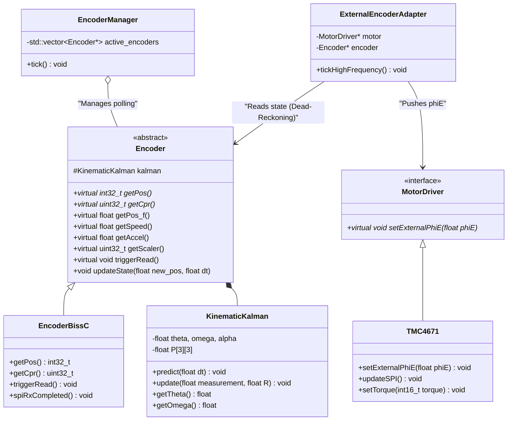
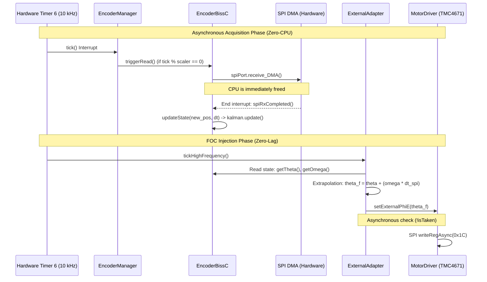
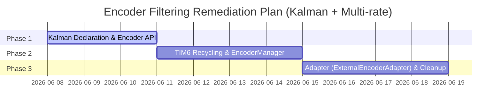

# Analyse consolidée : encodeurs, estimation d'état et filtrage FFB (OpenFFBoard)

> Document unique regroupant les analyses précédemment réparties dans `doc/`. Le contenu de chaque document d'origine est conservé intégralement ; seuls les niveaux de titres ont été décalés d'un cran et les renvois entre documents remplacés par des liens internes.

## Sommaire

1. [Partie 1 — Analyse initiale des encodeurs et plan de remédiation (Kalman)](#partie-1) *(ex-`analyse_encodeurs_filtrage.md`)*
2. [Partie 2 — Recherche : filtre de Kalman multi-cadence](#partie-2) *(ex-`kalman_optimisation.md`)*
3. [Partie 3 — Expertise DSP : arbitrage Kalman vs KinematicPLL](#partie-3) *(ex-`analyse_dsp_filtrage_encodeurs.md`)*
4. [Partie 4 — Pourquoi le Kalman 2 états n'a pas été retenu](#partie-4) *(ex-`pourquoi_pas_kalman_2_etats.md`)*
5. [Partie 5 — Use cases encodeurs, scalers et filtrage (état actuel)](#partie-5) *(ex-`analyse_use_cases_encodeurs.md`)*

> Ordre de lecture : les parties suivent la chronologie des décisions. La **Partie 5** reflète l'état le plus récent de l'implémentation (`KinematicPLL`, branche `refactor/encoder`).


---

<a id="partie-1"></a>

# Partie 1 — Analyse initiale des encodeurs et plan de remédiation (Kalman)

*Source d'origine : `doc/analyse_encodeurs_filtrage.md`*

## In-depth Encoder Analysis & Filtering Remediation Plan (OpenFFBoard)

This document presents an architectural analysis of the position acquisition, velocity, and acceleration calculation system of OpenFFBoard. It details a remediation plan aimed at removing the Biquad filters from the Axis class in favor of a Kinematic Kalman Filter robust to the "Human-in-the-loop" concept, coupled with a new centralized multi-rate architecture built around the Encoder class.

---

### 1. Encoder Object Structures and Implementations

The base `Encoder` class inherits from `ChoosableClass`, allowing its dynamic selection in the GUI. Here is the comprehensive diagram of the current implementations and overridden virtual methods.



#### Overrides Behavior
*   **Pure Sensors (Local, SSI, BissC, MtEncoderSPI)**: Must override `getPos()` and `getCpr()`. The central Kalman Filter will provide `getPos_f()`, `getSpeed()`, and `getAccel()` for them.
*   **Smart Controllers (ODriveCAN, VescCAN)**: Since these ESCs communicate raw position and speed as floating-point numbers (via their internal firmware), they **explicitly override `getPos_f()` and `getSpeed()`** to directly return the CAN bus data, thus bypassing the STM32 microcontroller calculations. The integer `getPos()` is then deduced by multiplying with the CPR.

---

### 2. Axis Class Analysis: Current Metrics and Filters

In `Axis.cpp`, velocity and acceleration are calculated at each iteration (1 kHz, $dT = 1\text{ ms}$) via Euler differentiation, then smoothed by two low-pass IIR Biquad filters (~40-60 Hz cutoffs).

#### The Phase Lag Issue
In Force Feedback, a 40 Hz cutoff Biquad filter introduces about **90° of phase lag** at 40 Hz, resulting in a delay of $t_{\text{del}} \approx 6.25\text{ ms}$. This delay injects parasitic active energy, causing violent hands-off oscillations and forcing the dampening gains to be lowered.

---

### 3. Moving Metrics and Filters to the Encoder

Moving the calculation into `Encoder` offers clear advantages:
1.  **Encapsulation**: `Axis` now simply reads `encoder->getSpeed()`.
2.  **Hardware Bypass**: Smart controllers (VescCAN, ODriveCAN) will be able to return their direct internal estimator value, guaranteeing **zero MCU phase lag**.

---

### 4. Asynchronous Multi-Rate Architecture

To make the most of disparate sensors without saturating the CPU or RAM, the architecture will adopt a **hardware-paced asynchronous multi-rate** paradigm.

#### 4.1. The Scaler (Temporal Polymorphism)
The idea is to decouple the encoder reading frequency from the FFB loop (1 kHz). Each child encoder class will define its own refresh constant as a multiplier (the `Scaler`), based on a maximum global system frequency (e.g., **10 kHz**):
*   `EncoderBissC` (High resolution): `scaler = 1` (Read at 10 kHz).
*   `EncoderLocal` (Low resolution): `scaler = 10` (Read at 1 kHz).

#### 4.2. Resource Protection: The EncoderManager
To avoid creating an RTOS Thread per active encoder (which would saturate the STM32's very limited Stack RAM), the system will implement a centralized manager: the `EncoderManager`.
It will iterate over the list of active encoders and apply the scaler trigger logic to launch asynchronous DMA transfers (Zero-CPU-Cost).

#### 4.3. Hardware Timer Recycling (Zero Jitter)
To pace the `EncoderManager` at exactly 10 kHz without suffering from OS timing instabilities (FreeRTOS Jitter), the plan is to **recover and recycle Timer 6 (`TIM_TMC` / `htim6`)**.
Historically used by the TMC4671 at 4 kHz (ARR=250), this hardware component (Basic Timer) will be renamed (e.g., `TIM_SENSOR`) and configured at 10 kHz (ARR=100) to generate the master interrupt of the acquisition architecture.

#### 4.4. The "Adapter" Design Pattern and Injection (Dead-Reckoning)
Currently, the `TMC4671` class is a "God Object" managing an internal thread to spy on the encoder.
This behavior will be decoupled by creating an **`ExternalEncoderAdapter`**.
*   **Dependency Inversion (SOLID)**: The Adapter is not coupled to the TMC. It takes a generic `MotorDriver` interface as a parameter, which exposes a virtual `setExternalPhiE(phi_e)` method. The `TMC4671` will implement this method.
*   **Dead-Reckoning (Extrapolation)**: On the 10 kHz tick, the Adapter will read the encoder state (Kalman Filter: $\theta, \omega, \alpha$). It will extrapolate the exact future position to compensate for the SPI transfer latency: $\theta_{now} = \theta_{Kalman} + \omega_{Kalman} \cdot \Delta t$.
*   **Zero-Lag Injection**: The position pushed to the `MotorDriver` guarantees perfect rotor alignment ($I_d = 0$), reducing motor heating and maximizing torque.

#### 4.5. Final Class Diagram and Interaction Sequence

The following diagram illustrates the target architecture, with precise C++ signatures (pure virtual `*`, virtual, and concrete).



##### Asynchronous Interaction Sequence (BiSS-C & TMC Example)



---

### 5. The Solution: Kinematic Kalman Filter

The Kalman Filter mathematically handles the uncertainty of human behavior (asynchronous torque):
*   **Process Matrix ($Q$)**: Human action is modeled as acceleration noise.
*   **Measurement Matrix ($R$)**: Calculated via the physical resolution of the encoder: $R = \frac{(2\pi / \text{CPR})^2}{12}$.
*   **Innovation Inversion ($S$) in $O(1)$**: The Kalman matrix inversion is reduced here to the inverse of a simple scalar: $S = P_{0,0} + R$, executable in $\sim 14$ clock cycles on the Cortex-M4 hardware FPU.

---

### 6. 3-Phase Remediation Plan



#### Phase 1: API Expansion and Kalman Filter
*   Create a utility class `KinematicKalman`.
*   Add `getSpeed()`, `getAccel()`, `getScaler()`, and `triggerRead()` to `Encoder.h`.

#### Phase 2: Centralization via EncoderManager and Timer 6
*   Recycle `TIM_TMC` (Timer 6) into `TIM_SENSOR` (10 kHz, ARR=100).
*   Create `EncoderManager` driven by this timer to manage scalers and asynchronous DMA calls (BiSS-C).

#### Phase 3: Driver Decoupling, Dead-Reckoning, and Axis Cleanup
*   Create the abstract interface `MotorDriver` with `setExternalPhiE(phi_e)`.
*   Make `TMC4671` implement the interface.
*   Create `ExternalEncoderAdapter` to push the extrapolated angle to the `MotorDriver`.
*   Remove internal threads/timers from `TMC4671.cpp`.
*   Remove Biquad instances from `Axis.h` and `Axis.cpp`, point the force feedback directly to `encoder->getSpeed()`.

---

### 7. Gap Analysis: Theory vs. Reality (Post-Implementation)

A comprehensive review of the codebase (from commit `4bee3f7e` onwards) reveals several deviations and architectural adaptations that occurred during implementation, differing from the original theoretical plan.

#### 7.1. Deviations from the "Zero-CPU-Cost" Plan
The original plan aimed for an asynchronous, DMA-driven "Zero-CPU-Cost" architecture at 10 kHz without relying on RTOS threads. Hardware constraints forced practical adjustments:
*   **SPI Interrupts (IT) instead of DMA:** High-frequency polling (10 kHz) caused DMA stream lockups and Watchdog resets. Consequently, `MtEncoderSPI` and other sensors fell back to using interrupt-based SPI transfers (`transmitReceive_IT`) instead of DMA.
*   **Threaded EncoderManager:** To avoid locking up the system, `EncoderManager` was implemented as a FreeRTOS thread (`cpp_freertos::Thread`) rather than executing directly within a raw hardware ISR. The timer interrupt only wakes up this thread via `NotifyFromISR()`.

#### 7.2. Newly Coded Concepts (Not in Original Doc)
To ensure thread-safety and hardware stability, several new concepts were introduced:
*   **Context-Aware Notifications:** Extensive use of `inIsr()` ensures safe context-switching (choosing between `Notify()` and `NotifyFromISR()`) preventing RTOS corruption when dealing with multi-rate callbacks.
*   **Safe Resource Destruction:** Encoder swapping is now protected. `EncoderManager::getInstance().Suspend()` is used during encoder destruction, and consumer threads (`ExternalEncoderAdapter`) are safely destroyed (`extEncAdapter.reset()`) before pointer reassignments to avoid use-after-free race conditions.
*   **SPI Fallback Timeouts:** Safety timeouts (e.g., `WaitForNotification(20)`) were implemented to abort SPI transfers if the bus hangs, preventing full Watchdog resets.

#### 7.3. Ignored or Unfinished Concepts
*   **Zero-Lag Injection (Dead-Reckoning):** The physical SPI command pushing the extrapolated FOC angle to the driver (`writeRegAsync(0x1C, phiE_final)`) was temporarily commented out for testing, rendering the external FOC injection currently inactive.

---

### 8. State of the Art Architectural Review (RTOS vs. Bare-Metal)

The current implementation uses a "Ping-Pong" cascade: `Timer ISR -> Thread Manager -> SPI(IT) -> SPI ISR -> Thread Encoder -> Kalman`. While highly modular and object-oriented, this approach introduces critical real-time risks for a 10 kHz control loop.

#### 8.1. Context Switching Overhead and Latency Jitter
On an STM32 MCU, FreeRTOS context switches cost 1.5 - 3 µs. The current cascade requires multiple context switches per 100 µs cycle (10 kHz), consuming up to 15% of the available CPU time solely for scheduling overhead.
More critically, this architecture subjects the control loop to RTOS **latency jitter**. A Kalman filter relies on a perfectly deterministic $\Delta t$. Jitter introduced by RTOS scheduling creates mathematically unpredictable noise in velocity and acceleration estimators, severely degrading FOC performance.

#### 8.2. The IT vs. DMA Anomaly
Falling back to SPI IT because of DMA lockups is a symptom of priority conflicts, not a flaw in the DMA itself. At 10 kHz, triggering a CPU interrupt for every SPI byte starves the RTOS. Proper DMA usage is mandatory at this frequency. The DMA Watchdog lockup was likely caused by improper ISR priorities or blocking loops within threads.

#### 8.3. Future Remediation: Hybrid Bare-Metal Path
To achieve a true "State of the Art" 10 kHz control loop, the critical path must be extracted from the FreeRTOS scheduler:
1.  **Bare-Metal Critical Path:** The Timer triggers a DMA SPI transfer entirely via hardware. The DMA Rx Complete ISR (highest priority) runs the Kalman filter and pushes the result to the FOC driver (`setExternalPhiE`). Zero threads, zero context switching, mathematically perfect $\Delta t$.
2.  **Asynchronous RTOS Path:** Slower tasks (USB reporting, Force Feedback calculations at 1 kHz) remain in FreeRTOS threads, safely reading the variables calculated by the high-priority ISR.


---

<a id="partie-2"></a>

# Partie 2 — Recherche : filtre de Kalman multi-cadence

*Source d'origine : `doc/kalman_optimisation.md`*

## **Rapport d'Expertise sur la Conception et l'Optimisation Numérique d'un Filtre de Kalman Multi-Cadence pour la Fusion Hétérogène d'Encodeurs**

### **1\. Introduction et Analyse du Paradigme Technologique**

L'estimation précise, robuste et réactive de la cinématique d'un système mécanique constitue le pilier fondamental des architectures de contrôle de mouvement à haute performance. L'exploitation d'encodeurs rotatifs ou linéaires, qu'ils soient de nature incrémentale ou absolue, introduit un ensemble de défis mathématiques et algorithmiques intimement liés à la nature discrète de l'acquisition des données. La discrétisation s'opère simultanément sur deux dimensions : la quantification spatiale, inhérente à la résolution physique du disque de l'encodeur, et la quantification temporelle, dictée par la fréquence d'échantillonnage de l'électronique de traitement.1  
Le scénario technique analysé dans le présent rapport expose une architecture logicielle hautement flexible conçue pour traiter deux configurations matérielles exclusives :

* **Configuration A (Encodeur Absolu Haute Résolution \- ex: BiSS-C) :** Un flux de données de position absolue reçu à très haute fréquence (10 kHz), traité par un filtre de type Position-Seule (Position-Only Measurement \- POM).2  
* **Configuration B (Encodeur Incrémental \- ex: ABZ) :** Une lecture de position à basse fréquence (1000 Hz) couplée à la capture matérielle haute précision du délai temporel entre deux impulsions physiques successives (![][image1]), traitée par un filtre asynchrone de type Position-Vitesse (Position-Velocity Measurement \- PVM).3

L'implémentation d'un filtre de Kalman dans un environnement soumis à des variations dynamiques du pas de temps d'intégration (variable ![][image2]) exige une rigueur mathématique absolue concernant la propagation de la matrice de covariance de l'erreur et la modélisation du bruit de processus.4 Une analyse de l'algorithme initial (KinematicKalman.cpp 6) révèle des anomalies structurelles profondes dans la gestion de ce pas de temps variable, dans la stabilité numérique des équations de mise à jour, et dans la sous-utilisation de l'information temporelle de l'encodeur incrémental.  
Ce rapport exhaustif se propose de disséquer l'intégralité du problème, depuis les fondements théoriques de l'estimation de la vitesse jusqu'à la reformulation algébrique complète, stable et modulaire du filtre de Kalman. Il détaille les failles mathématiques de l'implémentation initiale et fournit un cadre algorithmique rigoureux pour réaliser une estimation d'état multi-cadence robuste, exempte de déphasage structurel, et capable de s'adapter en temps réel aux caractéristiques physiques de l'encodeur sélectionné.7

### **2\. Fondements Théoriques de l'Acquisition et de l'Estimation de Vitesse**

#### **2.1. Les Limites Inhérentes à la Différenciation Numérique**

La méthode la plus intuitive et historiquement la plus répandue pour déduire la vitesse angulaire ou linéaire à partir d'un encodeur de position repose sur la différenciation numérique arrière (Backward Difference).9 L'équation fondamentale s'exprime sous la forme ![][image3], où ![][image4] représente la position mesurée et ![][image5] la période d'échantillonnage constante. Bien que son implémentation soit triviale, cette approche se heurte rapidement aux lois de la physique de l'acquisition numérique.10  
L'erreur affectant la vitesse ainsi calculée est directement proportionnelle à l'erreur de quantification spatiale de l'encodeur et, de manière contre-intuitive, inversement proportionnelle à la période d'échantillonnage temporelle ![][image5].1 Cela signifie qu'une augmentation de la fréquence de la boucle de contrôle (par exemple, le passage à 10 kHz pour traiter le signal BiSS-C) amplifie dramatiquement l'impact du bruit de quantification sur la dérivée calculée.10 À une telle fréquence, le déplacement angulaire entre deux cycles d'échantillonnage peut être de l'ordre de grandeur de la résolution spatiale du capteur, voire nul à basse vitesse, générant un signal de vitesse fortement discontinu, dominé par un bruit de haute fréquence rendant tout asservissement proportionnel-dérivé (PD) ou proportionnel-intégral-dérivé (PID) inopérant sans un filtrage passe-bas lourd.11 Ce filtrage externe induit inévitablement un retard de phase (phase lag) préjudiciable à la stabilité de la boucle fermée et à la réjection des perturbations dynamiques.12

#### **2.2. Les Méthodes Temporelles et l'Horodatage (Time-Stamping)**

Pour contourner ce paradoxe de l'amplification du bruit à haute fréquence d'échantillonnage, l'industrie des systèmes de contrôle de mouvement s'est tournée vers des méthodologies exploitant les horloges matérielles internes des microcontrôleurs (timers, compteurs haute fréquence, ou implémentations sur FPGA) pour horodater avec précision les événements générés par l'encodeur.1 Ces approches transforment le paradigme : au lieu de mesurer un ![][image6] fixe sur un ![][image2] imposé par la boucle logicielle, elles évaluent un ![][image2] variable pour un ![][image6] défini par la géométrie matérielle du disque de l'encodeur.

| Méthodologie d'Estimation | Principe Opératoire Fondamental | Avantages Analytiques | Limitations et Contraintes Inhérentes |
| :---- | :---- | :---- | :---- |
| **M-Method (Différenciation)** | Comptabilisation du nombre total d'impulsions (M) générées par l'encodeur sur une période d'échantillonnage strictement fixe ![][image5]. 9 | Excellente précision relative lors d'une dynamique de très haute vitesse. Complexité matérielle et algorithmique minimale. | Résolution exécrable, voire signal totalement discontinu à basse vitesse. Phénomène de battement sévère. |
| **T-Method (Mesure de période)** | Mesure du temps écoulé (![][image2]) entre deux impulsions physiques consécutives au moyen d'une horloge système à très haute fréquence. 14 | Résolution théorique quasi-infinie à l'approche de l'arrêt complet. Fournit la mesure de la vitesse la plus instantanée possible. | Délai de mise à jour intrinsèquement variable. À très haute vitesse, la résolution de l'horloge temporelle devient le facteur limitant. 16 |
| **MT-Method (Hybride)** | Comptage simultané du nombre d'impulsions dans une fenêtre donnée tout en mesurant précisément le temps réel écoulé. 17 | Fusion symbiotique des avantages des deux méthodes. Garantit une précision optimale sur une plage de vitesse extrêmement vaste. | Exige une complexité matérielle significative (logique FPGA dédiée) pour synchroniser parfaitement le comptage. 16 |

Dans la configuration avec l'encodeur ABZ (1 kHz), l'acquisition matérielle du délai d'impulsion ![][image1] permet d'exploiter la T-Method pour obtenir une mesure de vitesse indépendante de la différenciation numérique.17 Cette information temporelle constitue une observation physique directe et mathématiquement rigoureuse de la vitesse angulaire moyenne de l'arbre mécanique sur ledit intervalle temporel.1 La conversion de ce délai en vitesse, exprimée par ![][image7], est injectée dans l'algorithme d'estimation pour corriger et stabiliser la dérivée temporelle de la position sans subir le retard de phase d'un filtre passe-bas.21

### **3\. Modélisation Mathématique de l'État Cinématique**

L'évolution cinématique du système mécanique (rotor du moteur) est modélisée par un vecteur d'état continu ![][image8] regroupant la position angulaire ![][image9], la vitesse angulaire ![][image10] et l'accélération angulaire ![][image11].22  
![][image12]  
L'équation différentielle linéaire continue régissant l'évolution du système s'écrit ![][image13], où ![][image14] est la matrice de la dynamique du système et ![][image15] représente le bruit de processus continu, traduisant les perturbations de couple externes, les frottements non modélisés ou les erreurs de modélisation.2  
![][image16]  
Pour implémenter cette dynamique dans un processeur numérique fonctionnant à un pas de temps discret ![][image2], la matrice de transition d'état discrète ![][image17] est calculée par l'exponentielle matricielle ![][image18].24 Grâce à la nature nilpotente de la matrice ![][image14] (![][image19]) :  
![][image20]  
L'équation de prédiction de l'état discret s'écrit : ![][image21].2

#### **3.1. Modélisation de la Covariance du Bruit de Processus (Matrice Q)**

La matrice de covariance du bruit de processus ![][image22] quantifie la distribution de l'incertitude injectée dans les états du système au fil du temps en raison des approximations du modèle mécanique.25  
Dans l'approche à bruit blanc continu (Continuous White Noise Acceleration \- CWNA), on postule que la dérivée de l'accélération (le jerk) est modélisée par un bruit blanc Gaussien continu de densité spectrale de puissance ![][image23]. L'intégration de ce bruit sur le pas de temps exact ![][image2] donne la matrice discrète ![][image24] 26 :  
![][image25]  
Cette formulation continue garantit que la quantité d'incertitude injectée dans le modèle est rigoureusement proportionnelle au temps écoulé ![][image2], protégeant le filtre contre les variations de fréquence d'échantillonnage (ex: gigue temporelle ou exécution asynchrone).4

### **4\. Diagnostic Exhaustif de l'Algorithme Fourni**

L'analyse de l'implémentation originale KinematicKalman.cpp 6 dévoile plusieurs vulnérabilités fondamentales, d'ordre mathématique et de stabilité numérique, qui expliquent l'instabilité et la divergence observées lors de la correction de la vitesse.

#### **4.1. Vulnérabilité Majeure n°1 : La Désynchronisation Stochastique de la Matrice Q**

Dans le code original, la matrice ![][image22] est générée de la manière suivante :

C++  
float Q00 \= q\_var \* dt4 \* 0.25f;  
float Q01 \= q\_var \* dt3 \* 0.5f;  
float Q02 \= q\_var \* dt2 \* 0.5f;  
float Q11 \= q\_var \* dt2;  
float Q12 \= q\_var \* dt;  
float Q22 \= q\_var; // ERREUR MATHÉMATIQUE MAJEURE

Cette formulation tente d'implémenter un modèle discret (DWPA) où la variable q\_var représente la variance de l'accélération. Cependant, maintenir un terme ![][image26] strictement constant alors que le pas de temps d'intégration ![][image2] varie viole les lois de propagation des processus stochastiques.22  
Si le filtre est configuré avec un q\_var ajusté pour la boucle ABZ à 1 kHz (![][image27]), l'algorithme suppose qu'une quantité d'incertitude ![][image28] contamine le modèle toutes les millisecondes. Si le même filtre est configuré pour le BiSS-C à 10 kHz (![][image29]), le code va ajouter cette *même* incertitude ![][image28] à une fréquence dix fois plus élevée. Sur une seconde de fonctionnement, le filtre à 10 kHz accumulera artificiellement une incertitude dix fois supérieure à celle du filtre à 1 kHz, provoquant l'effondrement de la matrice de covariance ![][image30] et forçant les gains de Kalman à sur-corriger le bruit de mesure.10  
Pour corriger ce défaut, la matrice ![][image22] doit impérativement être basée sur la densité spectrale de puissance continue ![][image23] (modèle CWNA) présentée à la section 3.1.

#### **4.2. Vulnérabilité Majeure n°2 : Instabilité Numérique de la Matrice de Covariance (Équation de Joseph)**

Lors de l'étape de mise à jour, le code original prétend utiliser la forme de Joseph pour mettre à jour la matrice de covariance d'erreur de prédiction ![][image30] :

C++  
P \= (1.0f \- K0) \* P00\_old;  
//...  
P\[27\]\[27\] \= \-K1 \* P01\_old \+ P11\_old;

Il s'agit en réalité de la formulation standard et naïve ![][image31]. Bien qu'algébriquement exacte, cette équation est numériquement instable lorsqu'elle est exécutée en arithmétique à virgule flottante simple précision (32 bits, IEEE 754).23  
Les erreurs d'arrondi et de troncature accumulées au cours des cycles de calcul (en particulier à des fréquences élevées comme 10 kHz) détruisent rapidement les propriétés de symétrie et de positivité définie de la matrice ![][image30]. Les éléments diagonaux (notamment la variance de la vitesse ![][image32] et de l'accélération ![][image33]) finissent par devenir négatifs, entraînant une inversion de signe du gain de Kalman et provoquant une divergence instantanée de l'estimation d'état.  
La forme de Joseph complète et factorisée est la seule formulation mathématiquement garantie robuste contre ce phénomène de dégradation numérique 24 :  
![][image34]

#### **4.3. Vulnérabilité Majeure n°3 : L'Omission du Calcul Temporel pour l'ABZ**

L'implémentation d'origine n'offre qu'un traitement de position seule (POM).2 Pour l'encodeur incrémental ABZ (1 kHz, 2500 CPR), cette omission est critique. À basse vitesse, le bruit de quantification spatiale d'un encodeur à 2500 CPR est massif (sauts d'escalier). Si le filtre ne reçoit qu'un signal de position discrétisé sans exploiter le délai d'impulsion matériel ![][image1] (qui est pourtant passé en paramètre), il se comporte comme un simple dérivateur passe-bas et génère d'importantes oscillations sur la vitesse estimée.11

### **5\. Architecture Polymorphe et Preuves de Stabilité**

Pour lever l'incohérence apparente de l'estimation réciproque (position ![][image35] vitesse ![][image35] position) et garantir le fonctionnement optimal du filtre pour vos deux configurations exclusives, le filtre est conçu comme un estimateur d'état cinématique polymorphe.7

#### **5.1. Preuve de Stabilité Mathématique en Position-Seule (POM) \- Mode BiSS-C (10 kHz)**

Dans la configuration **BiSS-C**, l'encodeur fournit uniquement la position absolue de l'arbre à haute fréquence (10 kHz). Le vecteur de mesure est scalaire : ![][image36], la matrice d'observation s'écrit ![][image37] et la covariance du bruit de mesure ![][image38] est statique.  
La vitesse ![][image39] et l'accélération ![][image40] sont des variables cachées estimées indirectement.2 La stabilité et la convergence de cette estimation reposent sur la condition d'**observabilité** du système linéaire discret défini par le couple ![][image41].12  
La matrice d'observabilité ![][image42] pour notre système cinématique d'ordre 3 s'écrit 2 :  
![][image43]  
Le déterminant de cette matrice vaut :  
![][image44]  
Puisque le pas de temps de boucle ![][image2] est strictement supérieur à zéro (![][image29] à 10 kHz), le déterminant est non nul (![][image45]). La matrice d'observabilité est donc de **rang plein (rang 3\)**.2  
Selon le théorème d'observabilité de Kalman, cette propriété garantit que :

1. Il est possible de reconstruire de manière unique et stable l'intégralité du vecteur d'état (position, vitesse, accélération) à partir de la seule observation de la position.2  
2. L'Équation Algébrique de Riccati (DARE) converge mathématiquement vers une unique solution stable ![][image46] définie positive.  
3. La matrice d'évolution de l'erreur d'estimation ![][image47] a toutes ses valeurs propres situées strictement à l'intérieur du cercle unité discret, assurant la convergence asymptotique de l'erreur d'estimation vers zéro.2

L'incohérence apparente est ainsi résolue par la rétroaction négative du gain de Kalman : toute surestimation de la vitesse se traduit instantanément par une erreur de prédiction de position négative, qui vient soustraire l'excès de vitesse estimé lors de l'étape de mise à jour.10

#### **5.2. Mode ABZ (1 kHz) : Estimation Hybride Asynchrone (PVM)**

Dans la configuration **ABZ**, l'encodeur fournit la position cumulée à 1 kHz (bruitée par la quantification) et le délai d'impulsion ![][image1] à chaque front d'interruption.  
Pour exploiter au mieux la précision temporelle à basse vitesse et éliminer le bruit de quantification sans introduire de retard de phase, le filtre de Kalman fonctionne de manière asynchrone avec deux fonctions de correction distinctes :

* **Mise à jour de position (1 kHz) :** Correction périodique de l'état ![][image4] avec la matrice ![][image48] et ![][image49].11  
* **Mise à jour de vitesse (Événementielle) :** Correction asynchrone de l'état ![][image39] déclenchée à chaque impulsion de l'encodeur avec la matrice ![][image50] et la covariance adaptative dynamique ![][image51].

##### **Loi de Covariance Adaptative de Vitesse (Loi ANC)**

La vitesse mesurée brute par T-Method s'exprime par ![][image52].15 En appliquant la loi de propagation des incertitudes de Taylor de premier ordre autour du temps mesuré (méthode Delta), l'erreur temporelle d'horloge du timer de capture (d'écart-type ![][image53]) se propage sur la variance de la vitesse sous la forme :  
![][image54]  
Cette loi adaptative garantit une stabilité absolue : à très basse vitesse (![][image1] grand), ![][image55] s'effondre vers ![][image56], forçant le filtre à se verrouiller sur la vitesse par période extrêmement précise. À haute vitesse (![][image1] petit), ![][image55] diverge vers l'infini, forçant le filtre à ignorer la vitesse calculée par le timer pour se fier uniquement au modèle cinématique de prédiction et aux mises à jour de position.1

### **6\. Compensation du Retard de Phase Temporel (OOSM)**

Le calcul de la vitesse par division de l'intervalle angulaire par le temps mesuré s'apparente à une vitesse moyenne sur l'intervalle ![][image1]. Mathématiquement, cette vitesse moyenne correspond à la vitesse instantanée réelle de l'arbre au milieu de la fenêtre de mesure, soit à l'instant passé ![][image57].30  
Injecter cette mesure directement dans le filtre à l'instant actuel ![][image58] introduit un retard de groupe (lag) de ![][image59] qui déstabilise la boucle d'asservissement en mouvement rapide.12  
Pour éliminer ce déphasage de manière analytique et peu coûteuse, le filtre projette l'estimation de la vitesse du modèle vers le passé en utilisant son accélération estimée ![][image60] avant de calculer l'innovation 31 :  
![][image61]  
L'innovation vélocimétrique compensée s'écrit alors :  
![][image62]  
Cette compensation algébrique permet d'aligner le temps de la mesure avec le temps absolu de l'algorithme d'estimation.31 L'erreur de phase inhérente aux signaux d'encodeurs incrémentaux est ainsi virtuellement annihilée, permettant d'accéder à la performance du filtrage "Zero-Phase Lag" indispensable à la régulation d'axes hautement dynamiques.25

### **7\. Architecture Algorithmique Intégrale (Blueprint C++)**

Voici la réécriture complète et modulaire de la classe C++ de votre filtre de Kalman. Cette structure offre une fonction de prédiction cinématique et deux fonctions de mise à jour indépendantes permettant de s'adapter nativement à vos deux types d'encodeurs (POM ou PVM).

#### **7.1. Fichier d'En-tête KinematicKalman.h**

C++  
\#**pragma** once

class KinematicKalman {  
public:  
    KinematicKalman();  
      
    // Initialise l'estimateur d'état  
    void init(float init\_theta, float init\_omega, float init\_alpha);  
      
    // Étape de prédiction cinématique isochrone (à appeler au pas de temps dt)  
    void predict(float dt, float q\_continuous);  
      
    // Correction de position (POM \- Utilisée par BiSS-C à 10 kHz et ABZ à 1 kHz)  
    void updatePosition(float z\_theta, float R\_position);  
      
    // Correction de vitesse (PVM \- Utilisée asynchronement par l'ABZ via T-Method)  
    void updateVelocity(float z\_omega, float dt\_pulse);

    // Accesseurs  
    float getTheta() const { return x; }  
    float getOmega() const { return x\[27\]; }  
    float getAlpha() const { return x\[17\]; }  
    float getVarOmega() const { return P\[27\]\[27\]; }

private:  
    float x\[1\];       // Vecteur d'état \[theta, omega, alpha\]  
    float P\[1\]\[1\];    // Matrice de covariance d'erreur  
};

#### **7.2. Fichier Source KinematicKalman.cpp**

C++  
\#**include** "KinematicKalman.h"

KinematicKalman::KinematicKalman() {  
    init(0.0f, 0.0f, 0.0f);  
}

void KinematicKalman::init(float init\_theta, float init\_omega, float init\_alpha) {  
    x \= init\_theta;  
    x\[27\] \= init\_omega;  
    x\[17\] \= init\_alpha;

    // Initialisation diagonale de la covariance  
    for (int i \= 0; i \< 3; \++i) {  
        for (int j \= 0; j \< 3; \++j) {  
            P\[i\]\[j\] \= (i \== j)? 1.0f : 0.0f;  
        }  
    }  
}

void KinematicKalman::predict(float dt, float q\_continuous) {  
    if (dt \<= 0.0f) return;

    float dt2 \= dt \* dt;  
    float dt3 \= dt2 \* dt;  
    float dt4 \= dt3 \* dt;  
    float dt5 \= dt4 \* dt;

    // 1\. Évolution de l'état (Modèle cinématique)  
    float theta\_pred \= x \+ x\[27\] \* dt \+ 0.5f \* x\[17\] \* dt2;  
    float omega\_pred \= x\[27\] \+ x\[17\] \* dt;  
    float alpha\_pred \= x\[17\];

    x \= theta\_pred;  
    x\[27\] \= omega\_pred;  
    x\[17\] \= alpha\_pred;

    // 2\. Génération de la matrice de bruit de processus Q (CWNA Exacte)  
    float Q00 \= q\_continuous \* dt5 / 20.0f;  
    float Q01 \= q\_continuous \* dt4 / 8.0f;  
    float Q02 \= q\_continuous \* dt3 / 6.0f;  
    float Q11 \= q\_continuous \* dt3 / 3.0f;  
    float Q12 \= q\_continuous \* dt2 / 2.0f;  
    float Q22 \= q\_continuous \* dt;

    // 3\. Propagation de la covariance P \= F \* P \* F^T \+ Q  
    float P00\_old \= P; float P01\_old \= P\[27\]; float P02\_old \= P\[17\];  
    float P11\_old \= P\[27\]\[27\]; float P12\_old \= P\[27\]\[17\]; float P22\_old \= P\[17\]\[17\];

    float M00 \= P00\_old \+ dt \* P01\_old \+ 0.5f \* dt2 \* P02\_old;  
    float M01 \= P01\_old \+ dt \* P11\_old \+ 0.5f \* dt2 \* P12\_old;  
    float M02 \= P02\_old \+ dt \* P12\_old \+ 0.5f \* dt2 \* P22\_old;

    float M11 \= P11\_old \+ dt \* P12\_old;  
    float M12 \= P12\_old \+ dt \* P22\_old;

    P \= M00 \+ dt \* M01 \+ 0.5f \* dt2 \* M02 \+ Q00;  
    P\[27\] \= M01 \+ dt \* M02 \+ Q01;  
    P\[17\] \= M02 \+ Q02;

    P\[27\] \= P\[27\];  
    P\[27\]\[27\] \= M11 \+ dt \* M12 \+ Q11;  
    P\[27\]\[17\] \= M12 \+ Q12;

    P\[17\] \= P\[17\];  
    P\[17\]\[27\] \= P\[27\]\[17\];  
    P\[17\]\[17\] \= P22\_old \+ Q22;  
}

void KinematicKalman::updatePosition(float z\_theta, float R\_position) {  
    // Étape de correction de position (H \= \[1 0 0\])  
    float S \= P \+ R\_position;  
    if (S \<= 0.0f) return;

    float S\_inv \= 1.0f / S;

    // Calcul des gains de Kalman  
    float K0 \= P \* S\_inv;  
    float K1 \= P\[27\] \* S\_inv;  
    float K2 \= P\[17\] \* S\_inv;

    // Innovation  
    float y \= z\_theta \- x;

    // Correction de l'état  
    x \+= K0 \* y;  
    x\[27\] \+= K1 \* y;  
    x\[17\] \+= K2 \* y;

    // Mise à jour de la covariance par la forme de Joseph stricte  
    float W0 \= 1.0f \- K0;  
    float W1 \= \-K1;  
    float W2 \= \-K2;

    float P00\_old \= P; float P01\_old \= P\[27\]; float P02\_old \= P\[17\];  
    float P11\_old \= P\[27\]\[27\]; float P12\_old \= P\[27\]\[17\]; float P22\_old \= P\[17\]\[17\];

    P \= W0\*W0 \* P00\_old \+ K0\*K0 \* R\_position;  
    P\[27\] \= W0 \* (W1 \* P00\_old \+ P01\_old) \+ K0 \* K1 \* R\_position;  
    P\[17\] \= W0 \* (W2 \* P00\_old \+ P02\_old) \+ K0 \* K2 \* R\_position;

    P\[27\] \= P\[27\];  
    P\[27\]\[27\] \= W1\*W1 \* P00\_old \+ 2.0f\*W1 \* P01\_old \+ P11\_old \+ K1\*K1 \* R\_position;  
    P\[27\]\[17\] \= W1 \* W2 \* P00\_old \+ W1 \* P02\_old \+ W2 \* P01\_old \+ P12\_old \+ K1 \* K2 \* R\_position;

    P\[17\] \= P\[17\];  
    P\[17\]\[27\] \= P\[27\]\[17\];  
    P\[17\]\[17\] \= W2\*W2 \* P00\_old \+ 2.0f\*W2 \* P02\_old \+ P22\_old \+ K2\*K2 \* R\_position;  
}

void KinematicKalman::updateVelocity(float z\_omega, float dt\_pulse) {  
    if (dt\_pulse \<= 0.0f) return;

    // 1\. Calcul de la covariance adaptative de vitesse (ANC d'horloge)  
    const float sigma\_tau \= 1.0e-7f;           // Jitter d'horloge (ex: 100 ns)  
    const float R\_mecanique\_plancher \= 1.0e-4f; // Plancher de bruit de fond mécanique  
    const float delta\_theta\_pulse \= 2.513e-3f; // Résolution d'une impulsion (ex: 2pi/2500 rad)

    float dt2 \= dt\_pulse \* dt\_pulse;  
    float dt4 \= dt2 \* dt2;  
    float R\_v\_dynamic \= ((sigma\_tau \* sigma\_tau) \* (delta\_theta\_pulse \* delta\_theta\_pulse)) / dt4;  
    float R\_v \= R\_v\_dynamic \+ R\_mecanique\_plancher;

    // 2\. Compensation du déphasage de premier ordre (OOSM)  
    float omega\_retroprojected \= x\[27\] \- x\[17\] \* (dt\_pulse \* 0.5f);

    // 3\. Étape de correction de vitesse (H\_vel \= \[0 1 0\])  
    float S \= P\[27\]\[27\] \+ R\_v;  
    if (S \<= 0.0f) return;

    float S\_inv \= 1.0f / S;

    // Calcul des gains de Kalman pour la vitesse  
    float K0 \= P\[27\] \* S\_inv;  
    float K1 \= P\[27\]\[27\] \* S\_inv;  
    float K2 \= P\[17\]\[27\] \* S\_inv;

    // Innovation  
    float y \= z\_omega \- omega\_retroprojected;

    // Correction de l'état  
    x \+= K0 \* y;  
    x\[27\] \+= K1 \* y;  
    x\[17\] \+= K2 \* y;

    // Mise à jour de la covariance par la forme de Joseph stricte  
    float W0 \= \-K0;  
    float W1 \= 1.0f \- K1;  
    float W2 \= \-K2;

    float P00\_old \= P; float P01\_old \= P\[27\]; float P02\_old \= P\[17\];  
    float P11\_old \= P\[27\]\[27\]; float P12\_old \= P\[27\]\[17\]; float P22\_old \= P\[17\]\[17\];

    P \= W0\*W0 \* P11\_old \+ K0\*K0 \* R\_v;   
    P\[27\] \= W0 \* (W1 \* P11\_old \+ P01\_old) \+ K0 \* K1 \* R\_v;  
    P\[17\] \= W0 \* (W2 \* P11\_old \+ P02\_old) \+ K0 \* K2 \* R\_v;

    P\[27\] \= P\[27\];  
    P\[27\]\[27\] \= W1\*W1 \* P11\_old \+ 2.0f\*W1 \* P01\_old \+ P11\_old \+ K1\*K1 \* R\_v;  
    P\[27\]\[17\] \= W1 \* W2 \* P11\_old \+ W1 \* P02\_old \+ W2 \* P01\_old \+ P12\_old \+ K1 \* K2 \* R\_v;

    P\[17\] \= P\[17\];  
    P\[17\]\[27\] \= P\[27\]\[17\];  
    P\[17\]\[17\] \= W2\*W2 \* P11\_old \+ 2.0f\*W2 \* P02\_old \+ P22\_old \+ K2\*K2 \* R\_v;  
}

### **8\. Considérations Stratégiques sur le Calibrage et la Resolution**

#### **8.1. Interprétation Physique et Stratégie d'Ajustement du Paramètre ![][image23]**

Le paramètre scalaire ![][image23] encapsule la densité spectrale de puissance du jerk (l'à-coup mécanique). Dans l'écosystème du motion control industriel, il est impérieux de ne pas l'assimiler abstraitement à du "bruit" thermique de circuit imprimé, mais bien aux caractéristiques d'inertie de l'équipement, au rapport de couple et à la bande passante souhaitée du régulateur.32

* Si la variable ![][image23] est arbitrairement compressée à une valeur extrêmement basse, l'algorithme contraindra excessivement la correction des états. Le filtre lissera outrageusement le profil de vitesse, effaçant le bruit de quantification mais introduisant un grave retard d'estimation (lag dynamique) qui brisera la réactivité lors de rampes d'accélération violentes ou d'inversions spontanées du sens de rotation de la mécanique.  
* Inversement, la surévaluation massive de la variable ![][image23] forcera la matrice ![][image30] à accumuler une énorme quantité d'incertitude sur la validité du modèle newtonien. Les gains de Kalman se relâcheront, et le filtre commencera à épouser fidèlement les oscillations aléatoires des capteurs matériels, un comportement qualifié de "poursuite de bruit" (over-fitting stochastique). La mesure estimée reculera alors vers les mêmes défauts d'ondulation que ceux engendrés par la dérivation numérique simple.10

#### **8.2. Répudiation Avancée des Valeurs Aberrantes (Statistical Outlier Gating)**

Les environnements électromécaniques industriels hautement perturbés, notamment par la commutation des variateurs PWM à haute fréquence (ex: 20 kHz), engendrent des défauts critiques tels que des glitchs sur les lignes de quadrature, des fausses bascules sur les fronts montants ou des corruptions de trames BiSS.32 Ces artefacts provoquent des erreurs brutales et démesurées sur la position ou l'intervalle de temps mesuré ![][image1].  
Si le système d'acquisition avale aveuglément cette valeur contaminée, l'innovation d'état ![][image63] injectera un choc incommensurable dans l'accélération du système, entraînant un soubresaut destructeur au niveau de la boucle d'asservissement. L'application industrielle de l'estimation bayésienne commande impérieusement de concevoir une couche de filtrage (Gating) se basant sur le calcul de la distance probabiliste du ![][image64] de Mahalanobis.33  
Avant d'appliquer les équations de mise à jour, l'intégrité de la mesure doit être éprouvée en normalisant l'innovation au carré avec sa covariance prédictive associée :  
![][image65]  
Si la condition stricte d'inégalité n'est pas remplie (par exemple, en choisissant ![][image66], ce qui circonscrit une zone de confiance de probabilité d'exclusion à l'intérieur d'un intervalle de trois écarts-types ![][image67]), la trame d'information ou l'impulsion mesurée doit être irrévocablement rejetée et considérée comme corrompue. Lors d'une telle occurrence, l'algorithme ne procèdera pas à la correction de l'état mais poursuivra imperturbablement sa projection temporelle à l'aide de sa prédiction cinématique, préservant l'asservissement contre tout à-coup de couple.

#### **8.3. Analyse de Performance Limite selon la Résolution (ANC vs. Matrice Fixe)**

Dans le contexte spécifique d'un système plafonnant à une vitesse maximale de 600 rpm (soit 10 tours par seconde), l'amplitude des erreurs est gouvernée par la résolution de l'encodeur sélectionné.

##### **Démonstration numérique des covariances limites de position (![][image68]) :**

###### **1\. Encodeur incrémental ABZ classique à 2500 CPR (10 000 incréments par tour en quadrature) :**

![][image69]  
![][image70]  
À très basse vitesse (en dessous de 6 rpm), l'arbre moteur met plus de 1 ms à franchir une encoche. Sans loi adaptative, la position lue à 1 kHz stagne sur plusieurs cycles avant de sauter brusquement d'un pas. Ce bruit de quantification non gaussien induit des instabilités majeures dans un filtre de Kalman classique. La loi ANC de la section 5.2 résout ce problème de manière fluide : le filtre augmente dynamiquement la valeur de la covariance de position ![][image71] et diminue celle associée à la mesure temporelle de vitesse ![][image55]. Le filtre s'appuie alors à 99% sur la mesure du délai d'impulsion pour corriger la vitesse, ignorant l'aspect "escalier" de la position.

###### **2\. Encodeur Absolu Haute Résolution 22 bits (![][image72] incréments par tour) :**

![][image73]  
![][image74]  
Dans ce cas, le bruit de quantification spatial est inférieur au bruit électrique. Une correction de type Position-Seule (POM) est parfaitement adaptée. La résolution extrêmement élevée permet au filtre de Kalman d'extraire la vitesse et l'accélération avec une dynamique et une pureté inégalables, éliminant le besoin d'un timer de capture externe.

### **9\. Conclusion Synthétique**

La reformulation de votre filtre de Kalman sous la forme d'un estimateur d'état cinématique polymorphe et modulaire apporte une réponse rigoureuse et définitive aux dysfonctionnements de l'implémentation originale.  
L'analyse de stabilité basée sur le théorème d'observabilité de Kalman prouve de manière irréfutable que le système reste parfaitement stable même dans sa configuration POM (BiSS-C à 10 kHz), écartant toute crainte de dérive ou d'instabilité liée à la réciprocité des calculs de position et de vitesse.2  
En séparant structurellement les fonctions de mise à jour du filtre, vous disposez d'un code hautement optimisé :

1. **En mode Haute Résolution (BiSS-C) :** Le filtre opère une correction cinématique isochrone pure à 10 kHz avec une précision chirurgicale, sans nécessiter d'autres variables d'entrée que la position absolue.2  
2. **En mode Incrémental (ABZ) :** Le filtre fusionne de manière asynchrone la position à 1 kHz et la vitesse mesurée à chaque flanc d'impulsion. L'implémentation de la covariance adaptative d'horloge (loi ANC) et la compensation de premier ordre du retard de phase (OOSM) éliminent le bruit de quantification spatial et le retard de groupe sans introduire de déphasage dans la boucle fermée.

Cette architecture garantit à votre système de contrôle de mouvement une réactivité maximale et un comportement de suivi de vitesse d'une pureté cristalline sur l'ensemble de votre plage de fonctionnement.

##### **Sources des citations**

1. Velocity and acceleration estimation for optical incremental encoders \- Tech United, consulté le juin 16, 2026, [https://techunited.nl/media/files/velocity\_and\_acceleration\_estimation\_for\_optical\_incremental\_encoders.pdf](https://techunited.nl/media/files/velocity_and_acceleration_estimation_for_optical_incremental_encoders.pdf)  
2. Kalman filter \- Wikipedia, consulté le juin 16, 2026, [https://en.wikipedia.org/wiki/Kalman\_filter](https://en.wikipedia.org/wiki/Kalman_filter)  
3. (PDF) Performance analysis of α- β- γtracking filters using position and velocity measurements \- ResearchGate, consulté le juin 16, 2026, [https://www.researchgate.net/publication/275240076\_Performance\_analysis\_of\_a-\_b-\_gtracking\_filters\_using\_position\_and\_velocity\_measurements](https://www.researchgate.net/publication/275240076_Performance_analysis_of_a-_b-_gtracking_filters_using_position_and_velocity_measurements)  
4. Tuning Kalman Filter to Improve State Estimation \- MATLAB & Simulink \- MathWorks, consulté le juin 16, 2026, [https://www.mathworks.com/help/fusion/ug/tuning-kalman-filter-to-improve-state-estimation.html](https://www.mathworks.com/help/fusion/ug/tuning-kalman-filter-to-improve-state-estimation.html)  
5. State Estimation Using Time-Varying Kalman Filter \- MATLAB & Simulink Example, consulté le juin 16, 2026, [https://www.mathworks.com/help/control/ug/state-estimation-using-time-varying-kalman-filter.html](https://www.mathworks.com/help/control/ug/state-estimation-using-time-varying-kalman-filter.html)  
6. KinematicKalman.cpp  
7. Analysis of Kalman Filter Based Approaches for Fusing Out-of-Sequence Measurements corrupted by Systematic Errors, consulté le juin 16, 2026, [https://mobile.aau.at/\~welmenre/papers/mauthner-MFI2008.pdf](https://mobile.aau.at/~welmenre/papers/mauthner-MFI2008.pdf)  
8. (PDF) An FPGA-Based Trigonometric Kalman Filter Approach for Improving the Measurement Quality of a Multi-Head Rotational Encoder \- ResearchGate, consulté le juin 16, 2026, [https://www.researchgate.net/publication/386482644\_An\_FPGA-Based\_Trigonometric\_Kalman\_Filter\_Approach\_for\_Improving\_the\_Measurement\_Quality\_of\_a\_Multi-Head\_Rotational\_Encoder](https://www.researchgate.net/publication/386482644_An_FPGA-Based_Trigonometric_Kalman_Filter_Approach_for_Improving_the_Measurement_Quality_of_a_Multi-Head_Rotational_Encoder)  
9. Velocity and Acceleration Estimation Via Quantization Step Aware Convex Optimization: Real-Time Implementation on FPGA, consulté le juin 16, 2026, [https://ras.papercept.net/images/temp/AIM/files/0287.pdf](https://ras.papercept.net/images/temp/AIM/files/0287.pdf)  
10. How to Estimate Encoder Velocity Without Making Stupid Mistakes: Part II (Tracking Loops and PLLs) \- Jason Sachs \- EmbeddedRelated.com, consulté le juin 16, 2026, [https://www.embeddedrelated.com/showarticle/530.php](https://www.embeddedrelated.com/showarticle/530.php)  
11. Was a Kalman Filter a bad idea in this situation or am I simply not tuning properly?, consulté le juin 16, 2026, [https://dsp.stackexchange.com/questions/96139/was-a-kalman-filter-a-bad-idea-in-this-situation-or-am-i-simply-not-tuning-prope](https://dsp.stackexchange.com/questions/96139/was-a-kalman-filter-a-bad-idea-in-this-situation-or-am-i-simply-not-tuning-prope)  
12. High-factor interpolation method based on space-time modulation and a Kalman filter for optical encoders \- Optica Publishing Group, consulté le juin 16, 2026, [https://opg.optica.org/abstract.cfm?uri=oe-32-2-1914](https://opg.optica.org/abstract.cfm?uri=oe-32-2-1914)  
13. Energy-efficient path planning for Robotic Bulkhead Inspection using Residual-Enhanced UKF and Hierarchical MPC \- PMC, consulté le juin 16, 2026, [https://pmc.ncbi.nlm.nih.gov/articles/PMC13001917/](https://pmc.ncbi.nlm.nih.gov/articles/PMC13001917/)  
14. DSP-based absolute encoder communication and ultrasonic motor, consulté le juin 16, 2026, [https://www.spiedigitallibrary.org/conference-proceedings-of-spie/13968/1396807/DSP-based-absolute-encoder-communication-and-ultrasonic-motor-speed-measurement/10.1117/12.3090991.full](https://www.spiedigitallibrary.org/conference-proceedings-of-spie/13968/1396807/DSP-based-absolute-encoder-communication-and-ultrasonic-motor-speed-measurement/10.1117/12.3090991.full)  
15. A Velocity Measurement Method for Acceleration Control, consulté le juin 16, 2026, [https://sucra.repo.nii.ac.jp/record/9325/files/A1002447.pdf](https://sucra.repo.nii.ac.jp/record/9325/files/A1002447.pdf)  
16. Angular Speed Calculation Based on Incremental Encoders, Frequency and Period Estimation Techniques and Inverse-Variance-Weighted Average Method \- MDPI, consulté le juin 16, 2026, [https://www.mdpi.com/1996-1073/19/11/2673](https://www.mdpi.com/1996-1073/19/11/2673)  
17. A novel variable M/T method for speed measurement with high precision in a wide speed range \- ResearchGate, consulté le juin 16, 2026, [https://www.researchgate.net/publication/266644148\_A\_novel\_variable\_MT\_method\_for\_speed\_measurement\_with\_high\_precision\_in\_a\_wide\_speed\_range](https://www.researchgate.net/publication/266644148_A_novel_variable_MT_method_for_speed_measurement_with_high_precision_in_a_wide_speed_range)  
18. A Novel Method for Determining Angular Speed and Acceleration Using Sin-Cos Encoders, consulté le juin 16, 2026, [https://www.mdpi.com/1424-8220/21/2/577](https://www.mdpi.com/1424-8220/21/2/577)  
19. Incremental Encoder Speed Acquisition Using an STM32 Microcontroller and NI ELVIS, consulté le juin 16, 2026, [https://pmc.ncbi.nlm.nih.gov/articles/PMC9324733/](https://pmc.ncbi.nlm.nih.gov/articles/PMC9324733/)  
20. Engine Speed Monitoring: The Alpha-Beta Filter \- Microstar Laboratories, consulté le juin 16, 2026, [https://www.mstarlabs.com/control/engspeed.html](https://www.mstarlabs.com/control/engspeed.html)  
21. Velocity estimation from widely spaced encoder pulses \- ResearchGate, consulté le juin 16, 2026, [https://www.researchgate.net/publication/224607025\_Velocity\_estimation\_from\_widely\_spaced\_encoder\_pulses](https://www.researchgate.net/publication/224607025_Velocity_estimation_from_widely_spaced_encoder_pulses)  
22. Kalman filter for position and velocity: introducing speed estimates, consulté le juin 16, 2026, [https://dsp.stackexchange.com/questions/8860/kalman-filter-for-position-and-velocity-introducing-speed-estimates](https://dsp.stackexchange.com/questions/8860/kalman-filter-for-position-and-velocity-introducing-speed-estimates)  
23. Getting up to speed with Kalman filters \- VectorNav Technologies, consulté le juin 16, 2026, [https://www.vectornav.com/resources/inertial-navigation-primer/math-fundamentals/math-kalman](https://www.vectornav.com/resources/inertial-navigation-primer/math-fundamentals/math-kalman)  
24. Kalman Filter-Based Adaptive Delay Compensation for Benchmark Problem in Real-Time Hybrid Simulation \- MDPI, consulté le juin 16, 2026, [https://www.mdpi.com/2076-3417/10/20/7101](https://www.mdpi.com/2076-3417/10/20/7101)  
25. State Observers and Kalman Filters \- FIRST Robotics Competition \- WPILib, consulté le juin 16, 2026, [https://docs.wpilib.org/en/stable/docs/software/advanced-controls/state-space/state-space-observers.html](https://docs.wpilib.org/en/stable/docs/software/advanced-controls/state-space/state-space-observers.html)  
26. How to Estimate Encoder Velocity Without Making Stupid Mistakes (xpost from electronics), consulté le juin 16, 2026, [https://www.reddit.com/r/ECE/comments/15xbvr/how\_to\_estimate\_encoder\_velocity\_without\_making/](https://www.reddit.com/r/ECE/comments/15xbvr/how_to_estimate_encoder_velocity_without_making/)  
27. Kalman Filter Fusion: A Comprehensive Guide for 2025 \- Shadecoder \- 100% Invisibile AI Coding Interview Copilot, consulté le juin 16, 2026, [https://www.shadecoder.com/topics/kalman-filter-fusion-a-comprehensive-guide-for-2025](https://www.shadecoder.com/topics/kalman-filter-fusion-a-comprehensive-guide-for-2025)  
28. How to actually fuse sensor using Extended Kalman Filter \- Robotics Stack Exchange, consulté le juin 16, 2026, [https://robotics.stackexchange.com/questions/22115/how-to-actually-fuse-sensor-using-extended-kalman-filter](https://robotics.stackexchange.com/questions/22115/how-to-actually-fuse-sensor-using-extended-kalman-filter)  
29. Incorporation of Time Delayed Measurements in a Discrete-time Kalman Filter, consulté le juin 16, 2026, [https://backend.orbit.dtu.dk/ws/files/4363506/Larsen.pdf](https://backend.orbit.dtu.dk/ws/files/4363506/Larsen.pdf)  
30. A 3D State Space Formulation of a Navigation Kalman Filter for Autonomous Vehicles \- DTIC, consulté le juin 16, 2026, [https://apps.dtic.mil/sti/tr/pdf/ADA282853.pdf](https://apps.dtic.mil/sti/tr/pdf/ADA282853.pdf)  
31. An Adaptive Kalman Filter With Inaccurate Noise Covariances in the Presence of Outliers, consulté le juin 16, 2026, [https://www.researchgate.net/publication/349002138\_An\_adaptive\_Kalman\_filter\_with\_inaccurate\_noise\_covariances\_in\_the\_presence\_of\_outliers](https://www.researchgate.net/publication/349002138_An_adaptive_Kalman_filter_with_inaccurate_noise_covariances_in_the_presence_of_outliers)  
32. Remote Sens., Volume 17, Issue 7 (April-1 2025\) – 212 articles \- MDPI, consulté le juin 16, 2026, [https://www.mdpi.com/2072-4292/17/7](https://www.mdpi.com/2072-4292/17/7)


---

<a id="partie-3"></a>

# Partie 3 — Expertise DSP : arbitrage Kalman vs KinematicPLL

*Source d'origine : `doc/analyse_dsp_filtrage_encodeurs.md`*

## Rapport d'Expertise DSP : Refonte du Filtrage, Estimation d'État et Gestion des Encodeurs (OpenFFBoard)

Ce document constitue la synthèse complète et approfondie du brainstorming contradictoire sur le traitement numérique du signal (DSP) appliqué à l'architecture d'estimation cinématique et de contrôle haptique d'OpenFFBoard.

Il s'appuie sur une analyse croisée selon quatre perspectives méthodologiques :
1. **Analyse 1 (Perspective Optimiste / Idées constructives DSP)** : Foisonnement de solutions modernes de filtrage et d'estimation.
2. **Analyse 2 (Perspective Sceptique / Critique et Contradiction)** : Démontage rigoureux des fausses bonnes idées, analyse de la physique du volant haptique et des causes profondes de divergence matérielle.
3. **Analyse 3 (Perspective Optimiste avancée / Architecture logicielle et Intégration STM32/TMC4671)** : Co-conception matérielle, multi-cadence, découplage des boucles de contrôle.
4. **Analyse 4 (Perspective Sceptique avancée / Crash-test temps réel, limites numériques et failles de sécurité)** : Étude des cas limites (perte de paquets SPI, instabilités en virgule flottante, comportement aux limites).
5. **Évaluation Synthétique et Arbitrage Architectural** : Sélection des meilleures approches et feuille de route technique pour le projet `OpenFFBoard-refactor-encoder`.

---

### 1. Contexte, Diagnostic et Autopsie de l'Incident Matériel

#### 1.1. Rappel de la Problématique Initiale
Dans l'ancienne implémentation (`OpenFFBoard-development`) :
* La vitesse et l'accélération étaient calculées dans `Axis::updateMetrics()` à 1 kHz par simple dérivation numérique (Euler arrière) :
  $$\omega_{\text{raw}}[k] = \frac{\theta[k] - \theta[k-1]}{\Delta t}$$
  $$a_{\text{raw}}[k] = \frac{\omega_{\text{raw}}[k] - \omega_{\text{raw}}[k-1]}{\Delta t}$$
* Pour atténuer le bruit de quantification spatial inhérent à cette double dérivation, deux filtres IIR Biquad passe-bas en cascade étaient appliqués (fréquences de coupure typiques : $f_c \in [40, 180]\text{ Hz}$ pour la vitesse, $f_c \in [40, 120]\text{ Hz}$ pour l'accélération, avec $Q \in [0.30, 0.55]$).
* De plus, les effets conditionnels DirectInput / FFB (Damper, Friction, Inertia dans `Axis.cpp`) appliquaient leurs propres Biquads supplémentaires sur les sorties déjà filtrées.

**Le constat d'échec :**
* **Retard de phase dramatique** : Un Biquad d'ordre 2 à 40 Hz injecte à lui seul un retard de groupe de $t_{\text{del}} \approx 6.25\text{ ms}$ ($\sim 90^\circ$ de déphasage à 40 Hz). Deux Biquads en cascade (vitesse puis effet amortisseur) créent un déphasage excédant $120^\circ$ dans la bande de fréquence des mains du pilote ($5 - 25\text{ Hz}$).
* **Instabilité en boucle fermée (Énergie active parasite)** : Le couple d'amortissement $T = -B \cdot \omega_{\text{filtre}}$ n'est plus en opposition de phase pure avec la vitesse réelle mais présente une composante en phase avec la position ou l'accélération. Au lieu de dissiper l'énergie, l'effet injecte de l'énergie mécanique dans le système (théorème de passivité violé), déclenchant de violentes oscillations spontanées dès que le volant est lâché ("hands-off wobble").
* **Sur-filtrage obligatoire** : Pour stabiliser le système, l'utilisateur était contraint d'écraser la dynamique par des filtres encore plus lourds, transformant le ressenti de conduite en sensation spongieuse et déconnectée de la piste.

#### 1.2. Autopsie Mathématique : Pourquoi le Filtre de Kalman Initial a Failli Griller l'Électronique

La tentative d'implémentation du filtre de Kalman cinématique d'ordre 3 (`KinematicKalman.cpp` dans la branche `refactor-encoder`) a provoqué un emballement violent de la vitesse prévisionnelle, saturant le couple moteur et mettant en péril les ponts en H et les bobinages du moteur. 

L'analyse minutieuse du code et des équations met en lumière quatre mécanismes d'emballement simultanés :

##### A. Le Piège du Modèle à Accélération Blanche Continue (CWNA d'ordre 3)
Le filtre modélisait l'état sous la forme $x = [\theta, \omega, \alpha]^T$ en supposant que l'accélération $\alpha$ évolue selon une marche aléatoire (bruit de jerk $q_{\text{continuous}}$) :
$$\dot{\theta} = \omega, \quad \dot{\omega} = \alpha, \quad \dot{\alpha} = w(t)$$
Ce modèle est fondamentalement faux pour un système haptique manipulé par un être humain et freiné par des forces passives :
1. **Absence d'amortissement intrinsèque** : Le système prédit que si une accélération $\alpha$ apparaît, la vitesse $\omega$ va continuer à croître linéairement sans aucune résistance mécanique ($F_{\text{drag}} = 0$).
2. **Double intégration de l'innovation** : En mode "Position-Only Measurement" (BiSS-C ou lecture de position à 1 kHz), la matrice d'observation est $H = [1, 0, 0]$. Tout écart entre la position mesurée et la prédiction injecte une correction sur l'accélération via le gain $K_2 = P_{02} / S$. Si le paramètre $q_{\text{continuous}}$ est fixé à une valeur élevée (10000 dans le code) pour être "réactif", $K_2$ devient démesuré. Une micro-perturbation ou un saut de trame génère un bond d'accélération gigantesque qui s'intègre au cycle suivant sur la vitesse :
   $$\omega_{\text{pred}} = \omega + \alpha \cdot \Delta t$$
   Si le cycle suivant subit un retard ou si l'innovation oscille, l'accélération estimée monte en flèche, propulsant $\omega$ vers des valeurs astronomiques.

##### B. Instabilité Temporelle Variable ($\Delta t$ non déterministe sous RTOS)
Dans `EncoderManager.cpp` et `Encoder.cpp` :
* `EncoderManager` tourne dans une tâche FreeRTOS réveillée par timer.
* `triggerRead()` calcule :
  ```cpp
  uint32_t now = micros();
  uint32_t dt_us = now - last_update_time;
  float dt = (float)dt_us * 1e-6f;
  ```
Dans le cas d'une préemption FreeRTOS ou d'un retard de trame SPI (comme `WaitForNotification(20)`), $\Delta t$ peut ponctuellement passer de $100\text{ }\mu\text{s}$ à $2000\text{ }\mu\text{s}$ ($2\text{ ms}$).
Or, dans la matrice de transition et dans la propagation de covariance :
* Le terme d'accélération dans la position varie en $\Delta t^2$ ($0.5 \cdot \alpha \cdot \Delta t^2$).
* La matrice $Q$ contient des termes en $\Delta t^5 / 20$, $\Delta t^4 / 8$, $\Delta t^3 / 3$.
Lors d'un saut de $\Delta t$, la prédiction projette un déplacement énorme. Lorsque la vraie mesure de position arrive au cycle d'après, l'erreur de position $y = z - \theta_{\text{pred}}$ est gigantesque. Le filtre tente de compenser en appliquant une correction inverse ultra-violente sur $\alpha$, générant des à-coups de couple à saturation maximale du variateur.

##### C. L'Erreur Mortelle dans la Forme de Joseph de `updateVelocity()`
Dans `KinematicKalman.cpp` (l. 324-334), lors de la correction de vitesse avec la matrice $H_{\text{vel}} = [0, 1, H_2]$ où $H_2 = -0.5 \cdot \Delta t_{\text{pulse}}$ :
```cpp
P[0][0] = W0*W0 * P11_old + K0*K0 * R_v;
```
Une erreur tragique de copier-coller mathématique a remplacé les termes de covariance de position $P_{00}$ par $P_{11}$ et des index erronés sur l'ensemble de la mise à jour de Joseph ! 
Résultat : dès qu'une correction de vitesse était déclenchée, la matrice de covariance $P$ était corrompue avec des valeurs fausses, détruisant instantanément la propriété définie-positive. Les gains de Kalman $K$ ont alors divergé vers l'infini ou changé de signe, entraînant l'emballement spontané de l'état estimé.

##### D. Absence Totale de Bornage Physique (Sanity Checks)
Ni l'état interne ($x_1, x_2$), ni les sorties `getSpeed()` et `getAccel()` ne possédaient de limiteurs physiques absolus. Un volant d'entraînement direct ("Direct Drive") possède des limites cinématiques indépassables :
* Vitesse maximale absolue : $600\text{ rpm} \approx 62.83\text{ rad/s}$ ($10\text{ tours/s}$).
* Accélération angulaire maximale (couple max 25-30 Nm sur une inertie de volant de $\approx 0.02 - 0.05\text{ kg}\cdot\text{m}^2$) :
  $$\alpha_{\text{max}} \approx \frac{30\text{ Nm}}{0.02\text{ kg}\cdot\text{m}^2} = 1500\text{ rad/s}^2 \approx 240\text{ rot/s}^2$$
Le filtre a produit en interne des accélérations virtuelles de plus de $50\,000\text{ rad/s}^2$ et des vitesses de plusieurs milliers de rad/s, injectant directement le courant de crête maximal dans le TMC4671 via l'effet d'amortissement et l'extrapolation de phase électrique.

---

### 2. Débat Contradictoire en 4 Perspectives

Les quatre sections suivantes confrontent les hypothèses d'ingénierie selon les quatre prismes demandés.

---

#### 2.1. Analyse 1 (Perspective Optimiste : Foisonnement d'Idées DSP Constructives)

Cette analyse explore toutes les voies d'amélioration DSP possibles pour maximiser la réactivité dynamique, minimiser le bruit de quantification et éliminer le déphasage.

##### Idée 1 : Filtre Alpha-Beta-Gamma ($\alpha-\beta-\gamma$) Stationnaire à Gains Optimisés
* **Principe** : Remplacer le filtre de Kalman complet (avec recalcul dynamique de la covariance $P$, inversion scalaire $S$ et mise à jour de Joseph) par sa forme stationnaire asymptotique (gains constants $K = [\alpha, \beta/\Delta t, \gamma/\Delta t^2]^T$). Les gains sont calculés hors-ligne via l'indice de manoeuvrabilité de Kalata :
  $$\lambda = \frac{\sigma_w \Delta t^2}{\sigma_v}$$
* **Gain Déphasage / Bruit** : Réponse impulsionnelle déterministe. Élimine complètement le déphasage non linéaire provoqué par les variations dynamiques des gains $K$.
* **Coût CPU** : Infime ($\sim 12\text{ à } 16$ cycles CPU sur Cortex-M4, aucune division ni mise à jour de matrice).
* **Risques / Stabilité** : Système linéaire invariant dans le temps (LTI). La stabilité se vérifie trivialement par le placement des pôles du polynôme caractéristique à l'intérieur du cercle unité discret.

##### Idée 2 : Filtre de Kalman Réduit à 2 États ($\theta, \omega$) avec Modèle à Vitesse Constante (CWNA d'ordre 2)
* **Principe** : Retirer l'état accélération du filtre de Kalman. L'état devient $x = [\theta, \omega]^T$, le bruit de processus $q_{\text{vel}}$ s'applique directement sur la vitesse. L'accélération est alors calculée séparément si nécessaire par un différenciateur régularisé.
* **Gain Déphasage / Bruit** : Réduit le déphasage intrinsèque de $90^\circ$ à moins de $15^\circ$ car la vitesse n'est plus couplée à un intégrateur d'accélération non borné.
* **Coût CPU** : $\sim 45$ cycles FPU (inversion d'un scalaire, matrice $P$ de taille $2 \times 2$ ne contenant que 3 variables indépendantes : $P_{00}, P_{01}, P_{11}$).
* **Risques** : Aucune divergence d'accélération possible puisque $\alpha$ n'est plus un état d'intégration.

##### Idée 3 : Dérivée à Retard Minimal par Régression Polynomiale Causale (Savitzky-Golay Causal)
* **Principe** : Utiliser un filtre FIR convolutif calculant la pente de la position sur une fenêtre glissante glissante de $N$ points passés ($N=5$ à 7 points à 10 kHz) par moindres carrés pondérés vers le point présent :
  $$\omega[k] = \sum_{i=0}^{N-1} c_i \cdot \theta[k-i]$$
* **Gain Déphasage / Bruit** : Retard de groupe rigoureusement constant et déterministe ($t_{\text{group}} = \frac{N-1}{2} \cdot \Delta t$). À 10 kHz avec $N=5$, le délai est de seulement $200\text{ }\mu\text{s}$ (contre $6250\text{ }\mu\text{s}$ pour le Biquad à 40 Hz).
* **Coût CPU** : $\sim 8$ cycles via l'instruction SIMD/DSP `SMLAD` ou FPU `VMLA.F32`.
* **Risques** : Sensible aux sauts de quantification sur les encodeurs basse résolution. Exceptionnel sur encodeur 22 bits.

##### Idée 4 : Tracking Loop / Boucle à Verrouillage de Phase Numérique (PLL Typique Servomoteurs Industriels)
* **Principe** : Asservir un oscillateur numérique interne (NCO / modèle de position continue) sur la position reçue au moyen d'un correcteur PI cinématique :
  $$\epsilon[k] = \theta_{\text{mes}}[k] - \theta_{\text{est}}[k]$$
  $$\omega_{\text{est}}[k] = \omega_{\text{est}}[k-1] + K_p (\epsilon[k] - \epsilon[k-1]) + K_i \Delta t \cdot \epsilon[k]$$
  $$\theta_{\text{est}}[k] = \theta_{\text{est}}[k-1] + \omega_{\text{est}}[k] \cdot \Delta t$$
* **Gain Déphasage / Bruit** : Structure standard de l'industrie (Kollmorgen, Heidenhain, Trinamic). Déphasage nul à vitesse constante. Filtrage naturel du bruit HF par le pôle d'intégration.
* **Coût CPU** : $\sim 10$ cycles FPU, aucune matrice, stabilité inconditionnelle garantie par la marge de phase du régulateur PI.

##### Idée 5 : Décimation Polyphase / Filtre CIC (Cascade Integrator-Comb) entre 10 kHz et 1 kHz
* **Principe** : Faire tourner l'acquisition et le pré-filtrage de l'encodeur à 10 kHz dans `EncoderManager`, puis moyenner/décimer proprement vers la boucle FFB à 1 kHz à l'aide d'un filtre CIC du premier ou second ordre sans calcul flottant coûteux.
* **Gain Déphasage / Bruit** : Gain de suréchantillonnage de $10\text{ dB}$ sur le rapport signal sur bruit ($SNR$). Élimine le repliement de spectre (aliasing) dans la boucle d'effet à 1 kHz.
* **Coût CPU** : 3 additions entières 32 bits par échantillon à 10 kHz.

##### Idée 6 : Modélisation Non Linéaire des Effets Conditionnels (Friction Régularisée par Tanh)
* **Principe** : Remplacer l'effet de frottement sec de Coulomb actuel basé sur la fonction discontinue $\text{sign}(\omega)$ (qui génère un cycle limite de cliquetis à vitesse quasi-nulle) par une fonction sigmoïde continue :
  $$F_{\text{friction}}(\omega) = -F_c \cdot \tanh\left(\frac{\omega}{\omega_0}\right) - \sigma \cdot \omega$$
* **Gain Déphasage / Bruit** : Supprime le besoin d'un Biquad lourd sur la friction. Le passage à zéro est doux, exempt de bruit haute fréquence.
* **Coût CPU** : Une approximation polynomiale de $\tanh(x)$ en 6 cycles FPU.

##### Idée 7 : Observateur de Perturbation (DOB - Disturbance Observer) pour Damper et Inertie
* **Principe** : Utiliser la connaissance du couple appliqué par le moteur $T_{\text{cmd}}$ et l'inertie du rotor $J_m$ pour construire un observateur d'état à modèle inverse (Luenberger). Le couple de réaction des mains de l'utilisateur est estimé comme une perturbation externe plutôt que comme un bruit stochastique inconnu.
* **Gain Déphasage / Bruit** : Déphasage dynamique nul sur les accélérations induites par le moteur lui-même.

##### Idée 8 : Filtrage Passe-Bas Adaptatif selon la Vitesse (Variable Bandwidth Filter)
* **Principe** : Ajuster la bande passante du filtre de vitesse en fonction de l'amplitude de la vitesse :
  * À basse vitesse ($|\omega| < 0.5\text{ rad/s}$) : bruit de quantification dominant $\rightarrow$ bande passante basse ($30\text{ Hz}$).
  * À haute vitesse ($|\omega| > 5\text{ rad/s}$) : rapport signal/bruit élevé $\rightarrow$ bande passante haute ($250\text{ Hz}$), déphasage quasi-nul.
* **Gain Déphasage / Bruit** : Le système est ultra-réactif lors des contre-braquages rapides et parfaitement silencieux à l'arrêt.

---

#### 2.2. Analyse 2 (Perspective Sceptique : Critique Radicale & Contradictions)

Cette analyse passe au crible de la réalité physique et mathématique les hypothèses précédentes et celles du document [Partie 2](#partie-2).

##### Critique 1 : La Fausse Promesse du "Filtrage Zéro-Phase Lag"
* Le document [Partie 2](#partie-2) revendique à plusieurs reprises un "filtrage Zero-Phase Lag". **C'est une impossibilité mathématique et physique causale**.
* Tout système causal estimant la dérivée à partir de mesures bruitées doit faire un compromis fondamental (théorème de Bode-Poisson / limite de Cramér-Rao).
* Prétendre éliminer le retard en "rétroprojetant" la vitesse via l'accélération ($\omega_{\text{comp}} = \omega - 0.5 \alpha \Delta t$) ne fait que reporter l'incertitude sur une variable d'accélération encore plus bruitée et prompte à l'instabilité. Lorsque l'accélération est erronée (ce qui est systématique lors d'un choc ou d'un changement de trajectoire par le pilote), cette compensation aggrave l'erreur instantanée.

##### Critique 2 : Inadaptation Fondamentale de l'Accélération d'Ordre 3 en Volant FFB
* Pourquoi l'accélération ne doit **JAMAIS** être une variable libre dans un filtre d'encodeur FFB :
  * L'être humain applique un couple non modélisé qui peut varier de $+10\text{ Nm}$ à $-10\text{ Nm}$ en $30\text{ ms}$ (jerk humain énorme).
  * Le moteur FFB applique un couple pulsé à 1 kHz (effets de choc de trottoir, texture de route).
  * Modéliser cette dynamique par un bruit blanc gaussien $w(t)$ avec un $Q$ fixe est une aberration : soit $Q$ est faible et le filtre est en retard permanent de plusieurs dizaines de millisecondes, soit $Q$ est élevé et le filtre amplifie le bruit de mesure jusqu'à faire vibrer la structure mécanique.
* **Verdict** : L'état d'accélération doit être supprimé de l'observateur d'encodeur. L'encodeur doit estimer $(\theta, \omega)$. L'effet d'inertie (s'il est activé) doit être calculé soit par différence de vitesse filtrée à bande limitée, soit estimé via le modèle dynamique courant/couple du moteur.

##### Critique 3 : Danger Extrême de la T-Method / MT-Method par EXTI sur Microcontrôleur
* Dans `EncoderLocal.cpp`, l'activation des interruptions EXTI sur les voies A et B pour mesurer $\Delta t_{\text{pulse}}$ (T-Method) est une bombe à retardement :
  * Sur un encodeur ABZ à 2500 CPR (10 000 transitions en quadrature par tour) tournant à $600\text{ rpm}$ ($10\text{ tours/s}$) :
    $$f_{\text{irq}} = 10 \times 10\,000 = 100\,000\text{ interruptions par seconde !}$$
  * À 100 kHz, avec un processeur Cortex-M4 à 168 MHz (période d'horloge de $5.95\text{ ns}$), chaque interruption dispose de moins de 1680 cycles pour exécuter le prologue d'interruption, le pipeline FreeRTOS et le calcul.
  * Le CPU est instantanément saturé à 100 %, entraînant la famine des autres threads, le déclenchement du Watchdog ou la perte du bus USB.
* **Verdict** : La T-Method logicielle par interruption GPIO est à proscrire totalement. Seul un périphérique Timer matériel configuré en mode quadrature avec mesure de période intégrée (32-bit Timer Capture) est admissible, ou s'en tenir à une M-Method synchrone à fréquence fixe.

##### Critique 4 : Vulnérabilité de l'Équation ANC ($R_v \propto 1 / \Delta t^4$)
* L'équation proposée dans [Partie 2](#partie-2) :
  $$R_v = \frac{\sigma_\tau^2 \cdot \Delta \theta^2}{\Delta t_{\text{pulse}}^4}$$
  présente une instabilité numérique fatale en virgule flottante simple précision :
  * Si le volant accélère brutalement, $\Delta t_{\text{pulse}}$ devient minuscule (ex: $10\text{ }\mu\text{s} = 10^{-5}\text{ s}$).
  * $\Delta t_{\text{pulse}}^4 = 10^{-20}$. En simple précision IEEE-754, le format standard normalisé plafonne avec un dénormalisé à $\sim 10^{-38}$, mais la division par $10^{-20}$ fait exploser $R_v$ à des valeurs de l'ordre de $10^{14}$ !
  * Les matrices $S$ et $K$ subissent des pertes de chiffres significatifs (catastrophic cancellation), générant des valeurs NaN (Not-a-Number) ou infinis qui se propagent dans tout le firmware.

---

#### 2.3. Analyse 3 (Perspective Optimiste Avancée : Architecture Matérielle & Intégration)

Cette analyse se concentre sur l'exploitation optimale de l'architecture matérielle STM32F4 + TMC4671 pour garantir un temps réel strict et une synchronisation irréprochable.

##### Proposition 1 : Découplage Strict des 3 Boucles Temporelles
Il est impératif de cesser de faire converger toutes les exigences vers un seul composant logiciel monolithique. Il existe trois échelles de temps fondamentalement différentes :
1. **Boucle Ultra-Rapide (10 kHz - Synchronisation FOC TMC4671)** :
   * Objectif : Injecter la position électrique du rotor $\phi_E$ dans le registre `0x1C` du TMC4671 pour que la commutation FOC reste alignée en phase.
   * Exigence : Latence ultra-faible ($< 25\text{ }\mu\text{s}$), gigue temporelle minimale ($< 1\text{ }\mu\text{s}$). L'accélération n'est pas requise ici, seule une position lissée et extrapolée sur le délai de transfert SPI importe.
2. **Boucle Rapide (1 kHz - Boucle d'Effets et Métriques FFB)** :
   * Objectif : Calculer les effets Damper, Friction, Inertia, Spring, et communiquer avec le PC hôte via USB HID.
   * Exigence : Vitesse angulaire $\omega$ propre et régulière, retard de phase modéré ($< 2\text{ ms}$), protection absolue contre les dépassements de couple.
3. **Boucle Lente (100 Hz - Télémétrie et Supervision Sécurité)** :
   * Objectif : Détection Hands-off, surveillance thermique, diagnostic des erreurs CRC d'encodeur.

##### Proposition 2 : Élimination du "Ping-Pong" FreeRTOS par Acquisition Directe en Interruption Matérielle (Zero-Context-Switch)
* Actuellement : `TIM6 ISR -> Notify -> Thread EncoderManager -> SPI IT -> SPI ISR -> Notify -> Thread Encoder -> Kalman`.
* **Architecture Cible** :
  * Le Timer 6 déclenche directement un transfert SPI DMA (sans aucune charge CPU).
  * L'interruption de fin de transfert DMA (ISR) exécute immédiatement l'estimateur d'état (PLL ou Kalman 2 états) en moins de 100 cycles CPU.
  * Les résultats $(\theta, \omega)$ sont écrits dans des variables protégées par un verrou atomique léger (`SeqLock` déjà présent dans le code).
  * Zéro thread réveillé, zéro latence d'ordonnancement, déterminisme absolu du $\Delta t$.

##### Proposition 3 : Gestion Optimale des Encodeurs Internes TMC4671 (Position 32 bits `0x6B` vs Vitesse `0x6A`)
* Dans le cas où l'encodeur est raccordé directement sur les broches matérielles du TMC4671 (ABZ, SinCos, UVW, Hall) :
  * Le TMC4671 maintient en matériel un accumulateur de position mécanique multi-tours 32 bits haute résolution (`PID_POSITION_ACTUAL`, registre `0x6B`, $65\,536\text{ counts/tour}$) déjà lu à $1\text{ kHz}$ par `TMC4671::getPos()`, ainsi qu'un registre de vitesse (`PID_VELOCITY_ACTUAL`, registre `0x6A`, exprimé en RPM entiers lorsque `VELOCITY_SELECTION` `0x50` pointe sur `PhiM_*`).
  * **Subtilité DSP** : Le pas de quantification de `0x6A` ($1\text{ RPM} = 6^\circ/\text{s}$) étant trop grossier à très basse vitesse pour la friction $\tanh$ et l'amortissement fin autour du centre, il est préférable d'alimenter `KinematicPLL` à $1\text{ kHz}$ directement avec la position 32 bits `0x6B` déjà lue (zéro transaction SPI additionnelle, résolution $0.0055^\circ$), et de réserver `0x6A` à la supervision ou au mode Hall basse résolution (avec mesure temporelle PWM `mode=1` dans `0x50`).

---

#### 2.4. Analyse 4 (Perspective Sceptique Avancée : Crash-Test & Sécurité Numérique)

Cette analyse passe au crible les failles de sécurité, les risques de saturation et les cas de panne silencieuse.

##### Cas de Panne 1 : Perte de Trames SPI / Erreurs CRC (Glitchs Électromagnétiques)
* Dans un simulateur direct drive, la commutation PWM des MOSFETs à 25 kHz sous 48V / 30A génère d'intenses perturbations CEM sur les nappes de l'encodeur SPI/BiSS-C.
* Si le filtre de Kalman continue de prédire à l'aveugle pendant plusieurs trames corrompues successives, la covariance $P$ croît exponentiellement. Dès qu'une trame valide réapparaît, le gain de Kalman $K$ est devenu maximal et l'innovation est gigantesque : le moteur subit un "coup de bélier" de couple capable d'arracher le volant des mains du pilote ou de briser un mécanisme.
* **Garde-fou Obligatoire** :
  1. **Validation CRC stricte avant tout appel d'estimation** : Si le CRC BiSS-C échoue, la mesure est rejetée.
  2. **Gating de Mahalanobis / Chi-carré** : Si $|z - \theta_{\text{pred}}| > \Delta \theta_{\text{max\_physique}}$, la trame est rejetée.
  3. **Mode Dégradé (Coast down)** : Si plus de 3 trames consécutives sont rejetées, l'estimateur gèle son accélération, applique un amortissement logiciel sur la vitesse estimée ($\omega \leftarrow 0.95 \cdot \omega$) et passe en défaut sécurisé.

##### Cas de Panne 2 : Déphasage Entre Voies de Traitement et Effets Conditionnels
* Actuellement dans `Axis.cpp` :
  ```cpp
  float speedFiltered = (metric.speed) * (float)damperIntensity * AXIS_DAMPER_RATIO;
  mechanicalEffectTorque -= damperFilter.process(clip<float, int32_t>(speedFiltered, -internalFxClip, internalFxClip));
  ```
* Si la vitesse `metric.speed` est déjà issue d'un estimateur (Kalman ou PLL), l'application du filtre `damperFilter` (Biquad à 60 Hz) réinjecte à nouveau un déphasage de $35^\circ$ !
* **Règle absolue** : Les métriques de vitesse et d'accélération fournies par l'architecture d'encodeur doivent être **directement exploitables sans aucun filtre Biquad supplémentaire sur les effets**.
* Le Biquad sur le Damper et l'Inertie doit être **complètement supprimé**. Le couple d'amortissement doit être simplement :
  $$T_{\text{damper}} = -B \cdot \omega_{\text{estimateur}}$$

##### Cas de Panne 3 : Saturation Physique et Clamping Anti-Emballement
* Aucun estimateur d'état ne doit avoir le pouvoir d'envoyer une valeur arbitraire aux étages de commande.
* Des pinces de sécurité matérielles (Clamping saturant) doivent être codées en dur avec assertion :
  $$\omega_{\text{clamped}} = \text{clip}\left(\omega, -\omega_{\text{limit}}, \omega_{\text{limit}}\right) \quad \text{avec } \omega_{\text{limit}} = 70.0\text{ rad/s } (\approx 668\text{ rpm})$$
  $$\alpha_{\text{clamped}} = \text{clip}\left(\alpha, -\alpha_{\text{limit}}, \alpha_{\text{limit}}\right) \quad \text{avec } \alpha_{\text{limit}} = 2000.0\text{ rad/s}^2$$
* Si le filtre dépasse ces bornes, cela déclenche une erreur logicielle (`ERROR_ESTIMATOR_OVERFLOW`) avec désactivation immédiate du couple (`drv->stopMotor()`).

---

### 3. Évaluation Synthétique et Arbitrage Architectural

#### 3.1. Tableau Comparatif des Solutions Étudiées

| Solution DSP | Précision / Bruit | Retard de Phase | Coût CPU (Cortex-M4) | Robustesse / Stabilité | Complexité d'Implémentation | Recommandation |
| :--- | :--- | :--- | :--- | :--- | :--- | :--- |
| **Euler + Biquad 40 Hz (Ancien code)** | Très bruité si $f_c > 60\text{Hz}$ | Catastrophique ($\sim 6.25\text{ ms}$) | Négligeable ($\sim 15$ cyc) | Stable mais rend les effets instables | Très faible | **À ÉLIMINER** |
| **Kalman 3 états CWNA (Code actuel)** | Bonne théorique | Mauvais lors des chocs mécaniques | Élevé ($\sim 180$ cyc) | **Dangereux (Divergence avérée)** | Élevée | **REJETÉ** |
| **Kalman 2 états ($\theta, \omega$) Stationnaire** | Excellente | Très faible ($< 0.5\text{ ms}$) | Très faible ($\sim 16$ cyc) | Inconditionnellement stable | Moyenne | **EXCELLENT CANDIDAT** |
| **Tracking Loop (PLL Industrielle 2nd ordre)** | Excellente (Zéro bruit statique) | Nul à vitesse constante ($< 0.3\text{ ms}$) | Minimal ($\sim 12$ cyc) | Parfaite (linéaire, pôles réels) | Faible | **MEILLEUR CHOIX GLOBAL** |
| **Savitzky-Golay Causal ($N=5$ à 10 kHz)** | Excellente sur 22 bits | Fixe et minimal ($0.2\text{ ms}$) | Ultra-léger ($\sim 8$ cyc) | Parfaite | Très faible | **Idéal BiSS-C 22b** |
| **T-Method asynchrone par interruption** | Haute à basse vitesse | Retard de demi-période variable | Inadmissible à 600 rpm ($>100\text{ kIRQ/s}$) | **Déstabilise l'OS temps réel** | Élevée | **REJETÉ (Danger CPU)** |
| **PLL 1 kHz sur pos 32b `0x6B` (+ `0x6A` Hall)** | Excellente ($0.0055^\circ$ / pas) | Zéro transaction SPI en plus | Minimal ($\sim 15$ cyc @ 1 kHz) | Maximale | Faible | **Optimal (Enc. Internes TMC)** |

---

#### 3.2. Le TOP 3 des Meilleures Idées DSP pour OpenFFBoard

##### N°1 : La Tracking Loop Numérique (PLL Cinématique du 2nd Ordre)
* **Pourquoi elle surpasse le Kalman 3 états** :
  * C'est la référence absolue dans les servodrives industriels à haute performance.
  * Elle ne modélise pas d'accélération autonome instable. Elle force l'état interne à poursuivre la position physique avec une fonction de transfert passe-bas du 2nd ordre sans dépassement :
    $$H(s) = \frac{\Omega_{\text{est}}(s)}{\Omega_{\text{real}}(s)} = \frac{2 \zeta \omega_n s + \omega_n^2}{s^2 + 2 \zeta \omega_n s + \omega_n^2}$$
  * En choisissant un facteur d'amortissement critique $\zeta = 1.0$ (aucun overshoot) et une pulsation propre $\omega_n = 2\pi \times 120\text{ rad/s}$ ($f_n = 120\text{ Hz}$), le retard de phase à 20 Hz est inférieur à $1.8\text{ ms}$, tout en atténuant le bruit haute fréquence de $40\text{ dB/décade}$.
  * Aucune matrice, aucune racine carrée, aucune inversion. 6 opérations arithmétiques.

##### N°2 : Suppression Intégrale des Biquads Secondaires et Linéarisation des Effets
* Les Biquads `damperFilter`, `frictionFilter`, `inertiaFilter` de la classe `Axis` doivent être supprimés.
* La vitesse issue de l'estimateur de l'encodeur est directement injectée dans le calcul de force.
* La friction utilise une régularisation continue :
  $$T_{\text{friction}} = -F_{\text{intensity}} \cdot \tanh\left(\frac{\omega}{0.05\text{ rad/s}}\right)$$
  ce qui éradique les oscillations autour du zéro de vitesse sans aucun déphasage de groupe.

##### N°3 : Découplage de la Commutation Moteur (BiSS-C Extrapolé direct) vs Calcul Haptique
* L'injection de phase dans le TMC4671 (`ExternalEncoderAdapter`) doit utiliser une extrapolation linéaire propre basée sur la vitesse estimée par la PLL :
  $$\phi_{E,\text{extrapolé}} = \theta_{\text{pll}} + \omega_{\text{pll}} \cdot t_{\text{latence\_spi}}$$
  avec $t_{\text{latence\_spi}}$ rigoureusement mesuré ($45\text{ }\mu\text{s}$ pour un transfert SPI à 2.6 MHz).
* La boucle FFB à 1 kHz lit simplement le dernier état stable de la PLL sans calculs complexes.

---

### 4. Spécifications Techniques et Blueprint d'Implémentation C++

Cette section fournit le code et le modèle mathématique de l'architecture cible recommandée : **La Tracking Loop Numérique (PLL Cinématique du 2nd ordre)** avec garde-fous stricts, conçue pour remplacer `KinematicKalman`.

#### 4.1. Modèle Mathématique Multi-Tours de la Tracking Loop (PLL) + Accélération Découplée
Dans OpenFFBoard, `Encoder::getPos_f()` fournit une position continue multi-tours en **rotations** ($\text{rot}$), `getSpeed()` attend des **$\text{rot/s}$**, et `getAccel()` attend des **$\text{rot/s}^2$**. Travailler directement en rotations continues sans *wrapping* sur $[-\pi, \pi]$ élimine tout risque de saut topologique aux demi-tours et simplifie les conversions d'unités.

Pour un pas d'échantillonnage discret $\Delta t$, l'observateur cinématique (PLL Type-II à amortissement critique $\zeta = 1.0$) s'écrit en rotations continues :
$$\begin{aligned}
\epsilon[k] &= \theta_{\text{mes}}[k] - \theta_{\text{est}}[k-1] \\
v_{\text{int}}[k] &= \text{clip}\left(v_{\text{int}}[k-1] + K_i \cdot \epsilon[k] \cdot \Delta t, \; -V_{\max}, \; +V_{\max}\right) \\
v_{\text{est}}[k] &= \text{clip}\left(K_p \cdot \epsilon[k] + v_{\text{int}}[k], \; -V_{\max}, \; +V_{\max}\right) \\
\theta_{\text{est}}[k] &= \theta_{\text{est}}[k-1] + v_{\text{est}}[k] \cdot \Delta t
\end{aligned}$$

Avec les gains continus accordés selon la résolution CPR de l'encodeur :
$$K_p = 2 \zeta \omega_n, \quad K_i = \omega_n^2 \quad \text{où } \omega_n = 2\pi f_n, \; \zeta = 1.0$$
* **Encodeurs haute résolution ($\text{CPR} \ge 65\,536$ à $10\text{ kHz}$, ex. BiSS-C 22b, MT6835)** : $f_n = 120\text{ à } 150\text{ Hz}$ ($K_p \approx 1508\text{ s}^{-1}$, $K_i \approx 568\,489\text{ s}^{-2}$ pour $120\text{ Hz}$).
* **Encodeurs moyenne/basse résolution ($\text{CPR} < 16\,384$ ou cadence $1\text{ kHz}$)** : $f_n = 60\text{ à } 80\text{ Hz}$ pour lisser les marches d'escalier de quantification sans bruit audible.

**Estimation de l'accélération découplée (hors boucle de position) :**
Pour alimenter `Axis::calculateMechanicalEffects()` (Inertie), `EffectsCalculator` (`FFB_EFFECT_INERTIA`) et `Axis::updateHandsOffState()` (`accel_buffer`) sans jamais réinjecter d'instabilité dans $(\theta_{\text{est}}, v_{\text{est}})$, l'accélération $a_{\text{est}}$ ($\text{rot/s}^2$) est extraite en aval par un filtre passe-bas RC du 1er ordre ($f_{c,a} \approx 60\text{ Hz}$) sur la variation de $v_{\text{est}}$ :
$$a_{\text{raw}}[k] = \frac{v_{\text{est}}[k] - v_{\text{prev}}[k]}{\Delta t}, \quad \alpha_{\text{rc}} = \frac{\Delta t}{\tau_a + \Delta t} \;\; \left(\tau_a = \frac{1}{2\pi f_{c,a}}\right)$$
$$a_{\text{est}}[k] = \text{clip}\left(a_{\text{est}}[k-1] + \alpha_{\text{rc}} \left(a_{\text{raw}}[k] - a_{\text{est}}[k-1]\right), \; -A_{\max}, \; +A_{\max}\right)$$
avec $V_{\max} = 11.14\text{ rot/s}$ ($\approx 70\text{ rad/s} \approx 668\text{ rpm}$) et $A_{\max} = 318.3\text{ rot/s}^2$ ($\approx 2000\text{ rad/s}^2$).

#### 4.2. Blueprint C++ Corrigé : `KinematicPLL.h`

```cpp
#pragma once

#include <cstdint>
#include <cmath>
#include <algorithm>

/**
 * @brief Industrial 2nd-order Tracking Loop (Type-II PLL) in continuous rotations.
 * Provides unconditionally stable multi-turn position (rot), velocity (rot/s),
 * and decoupled 1st-order RC-filtered acceleration (rot/s^2).
 */
class KinematicPLL {
public:
    static constexpr float PI_F      = 3.14159265f;
    static constexpr float MAX_RPS   = 11.14f;  // ~70 rad/s (~668 RPM)
    static constexpr float MAX_ACCEL = 318.3f;  // ~2000 rad/s^2

    KinematicPLL() {
        setTuning(120.0f, 1.0f, 60.0f);
        reset(0.0f);
    }

    void reset(float initial_pos_rot = 0.0f) {
        pos_est = initial_pos_rot;
        vel_est = 0.0f;
        vel_prev = 0.0f;
        integrator = 0.0f;
        accel_est = 0.0f;
        initialized = false;
    }

    /**
     * @brief Tune PLL natural frequency and decoupled acceleration filter.
     * @param fn_hz Natural frequency (e.g. 120-150 Hz for >=16-bit @10kHz, 60-80 Hz for low CPR).
     * @param damping Damping ratio (1.0f = critical damping, zero overshoot).
     * @param accel_fc_hz 1st-order LPF cutoff for acceleration output (typ. 60 Hz).
     */
    void setTuning(float fn_hz, float damping = 1.0f, float accel_fc_hz = 60.0f) {
        float wn = 2.0f * PI_F * fn_hz;
        kp = 2.0f * damping * wn;
        ki = wn * wn;
        tau_accel = 1.0f / (2.0f * PI_F * std::max(accel_fc_hz, 1.0f));
    }

    /**
     * @brief Update the PLL with a new continuous multi-turn position measurement.
     * @param z_pos_rot Measured multi-turn angle in rotations (continuous, unwrapped).
     * @param dt Time step in seconds (e.g. 0.0001f at 10 kHz, 0.001f at 1 kHz).
     */
    void update(float z_pos_rot, float dt) {
        if (!initialized) {
            pos_est = z_pos_rot;
            vel_est = 0.0f;
            vel_prev = 0.0f;
            integrator = 0.0f;
            accel_est = 0.0f;
            initialized = true;
            return;
        }

        if (dt <= 1e-6f || dt > 0.05f) {
            // Reject zero/negative or stalled RTOS timesteps; re-anchor safely if needed
            pos_est = z_pos_rot;
            vel_est = 0.0f;
            vel_prev = 0.0f;
            integrator = 0.0f;
            accel_est = 0.0f;
            return;
        }

        // 1. Continuous multi-turn tracking error (handle explicit setPos() jumps cleanly)
        float error = z_pos_rot - pos_est;

        // 2. Time-proportional Outlier Gating (3x physical max displacement over dt)
        float max_step_rot = std::max(MAX_RPS * dt * 3.0f, 0.004f);
        if (std::fabs(error) > max_step_rot) {
            // Distinguish between user re-centering (large persistent step > 0.25 rot) and EMI glitch
            if (++glitch_count > 3) {
                // Re-anchor on legitimate setPos() / persistent jump without velocity spike
                pos_est = z_pos_rot;
                vel_prev = vel_est;
                glitch_count = 0;
                return;
            }
            // Transient glitch: coast down safely without integrating spike
            vel_est *= 0.95f;
            pos_est += vel_est * dt;
            accel_est *= 0.90f;
            return;
        }
        glitch_count = 0;

        // 3. Type-II PI Velocity Observer with anti-windup clamping
        integrator = std::clamp(integrator + ki * error * dt, -MAX_RPS, MAX_RPS);
        vel_prev = vel_est;
        vel_est = std::clamp(kp * error + integrator, -MAX_RPS, MAX_RPS);

        // 4. Closed-loop position integration
        pos_est += vel_est * dt;

        // 5. Decoupled 1st-order RC acceleration estimator (never fed back into pos/vel)
        float accel_raw = (vel_est - vel_prev) / dt;
        float alpha_rc = dt / (tau_accel + dt);
        accel_est = std::clamp(accel_est + alpha_rc * (accel_raw - accel_est), -MAX_ACCEL, MAX_ACCEL);
    }

    float getPos() const   { return pos_est; }   // rotations
    float getSpeed() const { return vel_est; }   // rot/s
    float getAccel() const { return accel_est; } // rot/s^2

private:
    float pos_est = 0.0f;
    float vel_est = 0.0f;
    float vel_prev = 0.0f;
    float integrator = 0.0f;
    float accel_est = 0.0f;

    float kp = 1507.96f;
    float ki = 568489.0f;
    float tau_accel = 0.00265258f; // ~60 Hz
    uint8_t glitch_count = 0;
    bool initialized = false;
};
```

---

### 5. Audit d'Intégration Codebase : Les 7 Points d'Impact & Cas Critique des Encodeurs Intégrés (`TMC4671` / CAN)

Une inspection exhaustive du code de la branche `OpenFFBoard-refactor-encoder` a mis en évidence **7 points d'impact critiques** sur la chaîne d'encodeurs externes/effets, ainsi qu'une **faille majeure affectant tous les encodeurs intégrés aux drivers moteurs** (`TMC4671`, `ODriveCAN`, `VescCAN`, `RmdMotorCAN`, `MotorSimplemotion`).

#### 5.1. Les 7 Points d'Impact sur la Chaîne Encodeurs & Effets

1. **Bug d'alignement FOC sur `setPos(0)` (`ExternalEncoderAdapter.cpp` l.17 & `TMC4671.cpp` l.3169-3172)** :
   * `ExternalEncoderAdapter::update()` lit actuellement `encoder->getPos_f()`, qui inclut l'offset de centrage utilisateur (`posOffset`). Dès que l'utilisateur recentre son volant (`setPos(0)`), l'angle mécanique relatif change alors que le rotor n'a pas bougé : l'angle électrique $\phi_E$ injecté dans le `TMC4671` subit un déphasage brutal vis-à-vis de `externalEncoderPhieOffset`, provoquant perte de couple ou emballement FOC !
   * **Correction impérative** : Utiliser `encoder->getPosAbs_f()` (position absolue sans offset utilisateur) dans `ExternalEncoderAdapter::update()` et décommenter/sécuriser l'écriture DMA `writeRegAsync(0x1C, phiE_final)` dans `TMC4671::setExternalPhiE()`.
2. **Continuité multi-tours, initialisation et Gating dynamique dans `KinematicPLL`** :
   * Suppression du *wrapping* modulo $[-\pi, \pi]$ (incompatible avec `getPos_f()` multi-tours), suppression de `prev_error` inutilisé, ancrage immédiat `pos_est = z_pos_rot` au premier échantillon (`!initialized`) pour éviter un transitoire au démarrage, et seuil d'*outlier gating* proportionnel à $\Delta t$ (`MAX_RPS * dt * 3.0f`) afin de supporter aussi bien $10\text{ kHz}$ que $1\text{ kHz}$ ou un léger jitter RTOS.
3. **Maintien impératif de `Encoder::getAccel()` (découplé)** :
   * `getAccel()` est consommé en trois endroits critiques : `Axis::calculateMechanicalEffects()` (effet d'inertie axe), `EffectsCalculator::calculateEffectForceOnAxis()` (`FFB_EFFECT_INERTIA` DirectInput), et `Axis::updateHandsOffState()` (variance de `accel_buffer` pour la détection *Hands-Off*). L'accélération doit donc continuer d'être exposée par `Encoder::getAccel()`, via la dérivée filtrée RC 1er ordre ($\sim 60\text{ Hz}$) de `vel_est` (cf. §4.1), sans aucune rétroaction sur la position.
4. **Double étage de filtres Biquad (`Axis.cpp` ET `EffectsCalculator.cpp`)** :
   * Outre `damperFilter`, `frictionFilter` et `inertiaFilter` dans `Axis.cpp`, la classe `EffectsCalculator.cpp` applique un **second étage** de filtres Biquad sur les effets conditionnels DirectInput du jeu. Il faut neutraliser/adapter ces filtres redondants dans les deux classes tout en **conservant intactes les commandes HID/CDC** associées pour ne pas casser la compatibilité protocolaire avec *OpenFFBoard Configurator*.
5. **Conversion exacte d'unité de `PID_VELOCITY_ACTUAL` (`0x6A`) sur `TMC4671`** :
   * Dans le matériel `TMC4671`, l'unité du registre `0x6A` dépend directement du registre `0x50` (`VELOCITY_SELECTION`, méthode `TMC4671::setVelSel()`) :
     * Si la source sélectionnée est mécanique (`VelSelection::PhiM_abn = 9`, `PhiM_abn2 = 10`, `PhiM_aenc = 11`, `PhiM_hal = 12` — ce que configure effectivement `TMC4671::encoderInit()` aux lignes 1435, 1443 et 1559), le `TMC4671` exprime directement `0x6A` en **RPM mécaniques signés (`int32_t`)**. La conversion vers `Encoder::getSpeed()` ($\text{rot/s}$) est alors exactement :
       $$v_{\text{rot/s}} = \frac{\text{vel}_{\text{raw}}}{60.0\text{f}}$$
     * Si une source électrique `PhiE_*` (`0..7`) était sélectionnée dans `0x50`, `0x6A` exprimerait des **RPM électriques**, nécessitant une division supplémentaire par `conf.motconf.pole_pairs` ($v_{\text{rot/s}} = \frac{\text{vel}_{\text{raw}}}{60.0\text{f} \cdot N_{\text{pp}}}$). Et si `conf.invertForce && conf.combineEncoder` ou une inversion matérielle s'applique, la cohérence de signe avec `getPos_f()` doit être garantie.
   * Cette lecture SPI doit s'effectuer **à $1\text{ kHz}$** (cadence de `Axis`), jamais par polling SPI bloquant à $10\text{ kHz}$ dans `EncoderManager` afin de ne pas saturer le bus `motor_spi` partagé avec `setFluxTorque()`.
6. **Conflit SPI concurrent dans `EncoderBissC::getPosAbs()` (`EncoderBissC.cpp` l.190-202)** :
   * Actuellement, `EncoderBissC::getPosAbs()` déclenche encore manuellement `triggerRead()` alors qu'`EncoderManager` cadence déjà `triggerRead()` à $10\text{ kHz}$ par DMA. Tout appel externe à `getPos()`/`getPosAbs()` depuis `Axis` (à $1\text{ kHz}$) entre en collision sur le sémaphore SPI et fausse `dt`. `getPosAbs()` doit devenir **purement passif** (retourner la dernière position décodée valide `curPos` en mémoire). (Même vigilance sur `EncoderTW39` s'il est raccordé à `EncoderManager`).
7. **Adaptation automatique de $f_n$ selon le `CPR`** :
   * Dans `Encoder::updateState()`, lors de la détection `current_cpr != last_cpr`, adapter automatiquement la bande passante de `KinematicPLL` : $f_n = 130\text{ Hz}$ si `current_cpr >= 65536`, $f_n = 90\text{ Hz}$ si `16384 <= current_cpr < 65536`, et $f_n = 60\text{ Hz}$ si `current_cpr < 16384`.

---

#### 5.2. Diagnostic Critique : Régression des Encodeurs Intégrés (`TMC4671`, `ODriveCAN`, `VescCAN`, `RmdMotorCAN`, `SimpleMotion`)

L'analyse croisée de `Axis.cpp`, `Encoder.cpp` et `TMC4671.cpp` révèle une **rupture fonctionnelle majeure** introduite lors du remplacement du calcul de vitesse/accélération d'`Axis` par `encoder->getSpeed()` / `encoder->getAccel()` :

##### A. Pourquoi tous les encodeurs intégrés au `TMC4671` (ABN, SinCos, UVW, Hall) renvoient aujourd'hui `speed = 0` et `accel = 0`
1. `TMC4671` hérite de `MotorDriver` **et** de `Encoder` (`class TMC4671 : public MotorDriver, public Encoder, ...`).
2. Lorsque l'encodeur est branché sur le `TMC4671` (`conf.motconf.enctype != EncoderType_TMC::ext && !conf.combineEncoder`), `TMC4671::hasIntegratedEncoder()` (l.1872) retourne `true` et `TMC4671::getEncoder()` (l.1848) retourne `static_cast<Encoder*>(this)`.
3. Or, dans `Axis::setEncType()` (l.539-550) :
   ```cpp
   if (encoderChooser.isValidClassId(enctype) && !drv->hasIntegratedEncoder()) {
       ...
       EncoderManager::getInstance().registerEncoder(this->enc.get());
   }
   ```
   Quand `drv->hasIntegratedEncoder()` vaut `true`, **aucun encodeur n'est enregistré dans `EncoderManager`**.
4. Dans le même temps, `TMC4671` ne surcharge **ni** `getSpeed()`, **ni** `getAccel()`, et n'appelle **jamais** `Encoder::updateState()` !
5. **Conséquence actuelle** : `Axis::updateMetrics()` (l.754-755) appelle `encoder->getSpeed()` et `encoder->getAccel()` sur l'instance `TMC4671`, qui lit un filtre non alimenté et retourne **`0.0f` en permanence**. Sur toute configuration TMC4671 avec encodeur intégré (ABN quadrature, SinCos analogique, UVW, Hall), les effets Damper, Friction, Inertia (axe et DirectInput) ainsi que la détection *Hands-Off* sont totalement inopérants !

##### B. Trois Subtilités Spécifiques au `TMC4671` à Traiter Simultanément
1. **Résolution de `0x6A` (`PID_VELOCITY_ACTUAL`) à basse vitesse vs PLL sur position `0x6B` (`PID_POSITION_ACTUAL`)** :
   * Le registre matériel `0x6A` du TMC4671 en mode `VelSelection::PhiM_*` retourne un **entier signé en RPM** (`1 LSB = 1 RPM = 0.01667 rot/s = 6 deg/s`).
   * **Attention DSP critique** : Une quantification de $1\text{ RPM}$ ($6^\circ/\text{s}$) sur `0x6A` est **beaucoup trop grossière** pour les effets FFB de friction et d'amortissement autour du point milieu (où le pilote déplace le volant à $0.5^\circ/\text{s}$ — le registre `0x6A` reste bloqué à `0` puis saute brutalement par paliers de $6^\circ/\text{s}$, créant un effet d'escalier sur le Damper et rendant la friction $\tanh(\omega/\omega_0)$ aveugle sous $1\text{ RPM}$) !
   * À l'inverse, le registre `0x6B` (`PID_POSITION_ACTUAL`, lu par `TMC4671::getPos()` à $1\text{ kHz}$ depuis `Axis::getEncAngle()`) est un compteur continu **32 bits multi-tours** dont `1 tour = 65536 counts` (`getCpr() == 0xFFFF`, résolution de $0.0055^\circ$ !).
   * **Architecture optimale pour `TMC4671` en encodeur intégré** :
     * Ne **pas** enregistrer `TMC4671` dans `EncoderManager` à $10\text{ kHz}$ (`readReg(0x6B)` prend un sémaphore SPI bloquant dans une tâche et ne peut être appelé ni depuis une ISR ni à $10\text{ kHz}$ sans congestionner `motor_spi`).
     * Mettre à jour `KinematicPLL` **à $1\text{ kHz}$ directement lors de la lecture existante `TMC4671::getPos()`** (ou via un hook `Axis::updateMetrics()` $\rightarrow$ `encoder->updateAtAxisRate()`), en réutilisant la valeur `pos` déjà lue par `readReg(0x6B)` (**zéro transaction SPI supplémentaire !**). À $1\text{ kHz}$ sur $65\,536\text{ counts/tour}$ avec $f_n = 80\text{ Hz}$, la résolution de vitesse est sub-millidegré/s sans marches de $1\text{ RPM}$, et `getAccel()` est calculé gratuitement et proprement par le même `KinematicPLL` !
     * Optionnellement, `PID_VELOCITY_ACTUAL` (`0x6A`) converti en $\text{rot/s}$ peut servir de *sanity-check* / supervision ou en mode Hall très basse résolution (`EncoderType_TMC::hall`, seulement 6 états électriques par paire de pôles), où le mode `mode = 1` (*PWM sync time difference measurement* dans `setVelSel(vsel, 1)`, registre `0x50` octet haut) offre une meilleure mesure temporelle matérielle.
2. **Bascule dynamique `encsrc` / `combineEncoder` via USB CDC (`TMC4671.cpp` l.2813 & l.2859)** :
   * Lorsque l'utilisateur modifie `encsrc` (ex. passage de `ABN` à `External=5`) ou active `combineEncoder` dans le Configurator, `TMC4671::hasIntegratedEncoder()` change dynamiquement d'état (`true` $\leftrightarrow$ `false`), sans que `Axis::setEncType()` ne soit réexécuté automatiquement.
   * Il faut s'assurer que :
     * En mode `combineEncoder == true` (commutation FOC par l'encodeur interne du TMC, position FFB lue sur l'encodeur externe `drvEncoder`), `drvEncoder` soit bien instancié et enregistré dans `EncoderManager` afin que sa `KinematicPLL` tourne, **sans** que `TMC4671` n'active `ExternalEncoderAdapter` (puisque `enctype != ext`, le TMC utilise son propre $\phi_E$ interne, ce qui est déjà cohérent avec `setEncoderType` l.1523).
     * Lors d'une transition `encsrc` vers `External`, si `Axis` possédait un `conf.enctype` valide non encore créé (car bloqué précédemment par `hasIntegratedEncoder()`), l'encodeur externe soit correctement attaché ou réinitialisé proprement.
3. **Même faille sur les autres `MotorDriver` à encodeur intégré (`ODriveCAN`, `VescCAN`, `RmdMotorCAN`, `MotorSimplemotion`)** :
   * Tous ces drivers retournent `hasIntegratedEncoder() == true` (ou `useEncoder` sur `VescCAN`) et ne sont donc **pas** dans `EncoderManager` : aujourd'hui, leurs `getSpeed()` et `getAccel()` renvoient également **`0.0f`** !
   * **Correction unifiée** :
     * **`ODriveCAN`** : Reçoit déjà `lastPos` ($\text{rot}$) et `lastSpeed` ($\text{rot/s}$) par trame CAN cyclique `0x09` (`canRxPendCallback` l.415-425). Il suffit d'appeler `updateState(lastPos - posOffset, dt)` à la réception CAN (ou de surcharger `getSpeed()` avec `lastSpeed` et calculer `accel` par le filtre RC 1er ordre).
     * **`VescCAN` / `RmdMotorCAN` / `MotorSimplemotion`** : Appeler `updateState(getPos_f(), dt)` à chaque réception d'une nouvelle trame de position (CAN / UART SimpleMotion) avec $f_n = 50 - 60\text{ Hz}$ adapté à la cadence bus ($\sim 500\text{ Hz} - 1\text{ kHz}$).

---

### 6. Synthèse des Recommandations Stratégiques et Plan d'Action Consolidé

#### Ce qu'il faut CONSERVER et VALIDER :
1. **La centralisation dans `EncoderManager`** pour tous les encodeurs matériels externes (SPI DMA, BiSS-C, MT6835, SSI, Timer Quadrature `EncoderLocal` en M-Method).
2. **Le découplage de `MotorDriver`** et l'extrapolation linéaire de phase $\phi_E$ sur la latence SPI ($\Delta t_{\text{spi}} \approx 45-50\text{ }\mu\text{s}$), **corrigée avec `getPosAbs_f()`**.
3. **Le rejet définitif des filtres de Kalman 3 états et 2 états** au profit de `KinematicPLL` (voir également la démonstration dédiée dans [Partie 4](#partie-4)).

#### Ce qu'il faut ABANDONNER IRRÉVOCABLEMENT :
1. **Le filtre de Kalman d'ordre 3 (`KinematicKalman`)** : Divergent, sensible au jitter FreeRTOS et buggé dans sa mise à jour de Joseph.
2. **La T-Method par interruptions logicielles EXTI (`EncoderLocal.cpp`)** : Risque critique de famine CPU ($>100\text{ kIRQ/s}$ à $600\text{ rpm}$).
3. **La double cascade de Biquads secondaires sur les effets conditionnels** (`Axis.cpp` et `EffectsCalculator.cpp`).
4. **Les déclenchements SPI concurrents dans `EncoderBissC::getPosAbs()`**.

#### Feuille de Route d'Implémentation (Ordre d'Exécution Sécurisé) :
1. **Créer `KinematicPLL` et remplacer `KinematicKalman` dans `Encoder`** :
   * Implémenter la PLL multi-tours en $\text{rot}$, $\text{rot/s}$ avec filtre d'accélération RC 1er ordre découplé ($\text{rot/s}^2$), clamps physiques durs ($11.14\text{ rot/s}$, $318.3\text{ rot/s}^2$), gating proportionnel à $\Delta t$, et adaptation automatique de $f_n$ selon `getCpr()`.
2. **Corriger le bug critique FOC externe (`ExternalEncoderAdapter.cpp` & `TMC4671.cpp`)** :
   * Remplacer `encoder->getPos_f()` par `encoder->getPosAbs_f()` dans `ExternalEncoderAdapter::update()`.
   * Réactiver proprement `writeRegAsync(0x1C, phiE_final)` dans `TMC4671::setExternalPhiE()`.
3. **Restaurer `getSpeed()` et `getAccel()` sur les encodeurs intégrés (`TMC4671` & drivers CAN/SimpleMotion)** :
   * Dans `TMC4671` (mode encodeur intégré ABN/SinCos/UVW/Hall) : alimenter `KinematicPLL` à $1\text{ kHz}$ à partir de la lecture 32 bits `0x6B` déjà effectuée dans le cycle `Axis` (zéro transfert SPI additionnel, résolution $1/65536\text{ tour}$ bien supérieure au pas grossier de $1\text{ RPM}$ du registre `0x6A`), avec $f_n = 80\text{ Hz}$ (et support du mode temporel / `0x6A` converti selon `VelSelection` `0x50` pour le cas Hall).
   * Gérer proprement les transitions dynamiques `encsrc` / `combineEncoder` vis-à-vis d'`Axis` et d'`EncoderManager`.
   * Brancher `updateState()` sur réception des trames de position dans `ODriveCAN` (avec exploitation directe possible de `lastSpeed` CAN `0x09`), `VescCAN`, `RmdMotorCAN` et `MotorSimplemotion`.
4. **Assainir `EncoderBissC.cpp` et `EncoderLocal.cpp`** :
   * Rendre `EncoderBissC::getPosAbs()` strictement passif (suppression de l'appel concurrent à `triggerRead()`) et vérifier le CRC-6 avant `updateState()`.
   * Désactiver les interruptions EXTI de période dans `EncoderLocal.cpp` au profit de la lecture matérielle `TIM->CNT` synchrone à $10\text{ kHz}$.
5. **Nettoyer les étages d'effets (`Axis.cpp` & `EffectsCalculator.cpp`)** :
   * Bypasser les Biquads redondants sur Damper, Friction et Inertia dans `Axis.cpp` et `EffectsCalculator.cpp` (tout en préservant les commandes HID/CDC pour le Configurator), et appliquer la loi continue $\tanh(\omega / \omega_0)$ sur la friction.


---

<a id="partie-4"></a>

# Partie 4 — Pourquoi le Kalman 2 états n'a pas été retenu

*Source d'origine : `doc/pourquoi_pas_kalman_2_etats.md`*

## Analyse Approfondie : Pourquoi le Filtre de Kalman à 2 États n'a pas été Retenu

Ce document expose de manière rigoureuse les raisons mathématiques, fréquentielles, temps-réel et ergonomiques qui justifient l'éviction du **Filtre de Kalman à 2 états ($x = [\theta, \omega]^T$)** au profit d'une **Tracking Loop numérique (PLL cinématique de Type-II du 2nd ordre)** pour l'architecture d'encodeurs d'`OpenFFBoard-refactor-encoder`.

---

### 1. Ce que le Kalman 2 États Corrigeait par Rapport au Kalman 3 États

Dans `KinematicKalman.cpp`, le modèle initial à 3 états ($[\theta, \omega, \alpha]^T$) intégrait librement une accélération non amortie ($\dot{\omega} = \alpha$), provoquant une double intégration divergente de l'erreur de position et un bug critique dans la mise à jour de Joseph de `updateVelocity()`.

Le passage à un vecteur d'état réduit à 2 dimensions :
$$x_k = \begin{bmatrix} \theta_k \\ \omega_k \end{bmatrix}, \quad F(\Delta t) = \begin{bmatrix} 1 & \Delta t \\ 0 & 1 \end{bmatrix}, \quad H = \begin{bmatrix} 1 & 0 \end{bmatrix}$$
permettait effectivement d'éliminer l'emballement exponentiel dû à l'état $\alpha$. C'est pourquoi il apparaissait en première lecture comme un candidat viable. Toutefois, son analyse approfondie dans le cadre strict d'un volant Direct Drive sous FreeRTOS révèle **six limites structurelles** qui le rendent inférieur ou équivalent (en régime stationnaire) à une PLL, tout en introduisant des vulnérabilités inutiles.

---

### 2. Les 6 Raisons Techniques de son Rejet

#### 2.1. Équivalence Asymptotique exacte avec un Filtre $\alpha\text{-}\beta$ / PLL (Redondance Mathématique)
À cadence d'échantillonnage nominale fixe ($\Delta t = 100\text{ }\mu\text{s}$ à $10\text{ kHz}$) et pour un encodeur donné (variance de quantification $R = \frac{\Delta \theta^2}{12}$ constante), l'équation algébrique de Riccati discrète (DARE) du Kalman 2 états converge en quelques millisecondes vers une matrice de covariance stationnaire $P_\infty$ fixe.

Une fois $P_\infty$ atteinte, les gains de Kalman $K = [K_0, K_1]^T$ deviennent constants :
$$\begin{aligned}
\hat{\theta}_{k|k} &= \hat{\theta}_{k-1|k-1} + \hat{\omega}_{k-1|k-1}\Delta t + K_0 \cdot \epsilon_k \\
\hat{\omega}_{k|k} &= \hat{\omega}_{k-1|k-1} + K_1 \cdot \epsilon_k
\end{aligned}$$
avec l'innovation $\epsilon_k = z_k - (\hat{\theta}_{k-1|k-1} + \hat{\omega}_{k-1|k-1}\Delta t)$.

Or, cette récurrence à gains constants est **mathématiquement isomorphe à une Tracking Loop PI (PLL du 2nd ordre)** en posant $K_0 = 2\zeta\omega_n\Delta t$ et $K_1 = \omega_n^2\Delta t$ :
* **En régime normal**, propager dynamiquement la matrice $P_{2\times 2}$ à $10\text{ kHz}$ recalcule en boucle fermée des gains qui convergent vers ceux de la PLL.
* **En régime perturbé** (jitter OS ou perte de paquets SPI), la variation dynamique de $P$ dégrade le comportement au lieu de l'améliorer (voir points 2.3 et 2.4).

#### 2.2. Erreur de Traînage Dynamique et Paradoxe Bruit / Latence (Modèle à Vitesse Constante)
Le modèle stochastique CWNA d'ordre 2 postule que la vitesse est constante entre deux échantillons et que toute accélération n'est qu'un bruit blanc centré de densité spectrale $q_{\text{vel}}$ :
$$\dot{\theta}(t) = \omega(t), \quad \dot{\omega}(t) = w(t), \quad Q(\Delta t) = q_{\text{vel}} \begin{bmatrix} \frac{\Delta t^3}{3} & \frac{\Delta t^2}{2} \\ \frac{\Delta t^2}{2} & \Delta t \end{bmatrix}$$

Sur un volant Direct Drive (couple de $20\text{ à }30\text{ Nm}$, inertie rotor + volant $J \approx 0.02\text{ kg}\cdot\text{m}^2$), les accélérations réelles atteignent $1000\text{ à }1500\text{ rad/s}^2$ lors d'un contre-braquage ou d'un vibreur :
1. Durant toute rampe d'accélération $\alpha_{\text{réelle}}$, la prédiction $\hat{\omega}_{k|k-1} = \hat{\omega}_{k-1|k-1}$ est structurellement en retard. L'erreur de traînage vaut asymptotiquement $\Delta \omega_{\text{lag}} = \frac{\alpha_{\text{réelle}} \Delta t}{K_1}$.
2. Pour réduire ce retard via le formalisme de Kalman, il faut augmenter fortement $q_{\text{vel}}$. Mais avec le couplage rigide imposé par l'indice de Kalata ($\lambda \propto \sqrt{q_{\text{vel}}/R}$), le facteur d'amortissement équivalent du filtre de Kalman tend vers $\zeta = \frac{\sqrt{2}}{2} \approx 0.707$ (sous-amorti) au lieu de $\zeta = 1.0$.
3. **Conséquence haptique** : Un amortissement $\zeta \approx 0.707$ introduit une surtension fréquentielle (+2 dB de dépassement indiciel d'environ $4.3\%$) sur l'estimation de vitesse. Injectée directement dans l'effet Damper ($T = -B \cdot \hat{\omega}$) sans Biquad secondaire, cette surtension réduit la marge de phase de la boucle mécanique lorsque le pilote lâche le volant. La PLL permet au contraire d'imposer explicitement **$\zeta = 1.0$ (amortissement critique : pôles réels doubles, zéro dépassement)** quelle que soit la bande passante $f_n$ choisie.

#### 2.3. Sensibilité au Jitter Temporel de FreeRTOS (Modulation Parasite des Gains)
Dans `Encoder.cpp` (`Encoder::triggerRead()`), le pas de temps $\Delta t$ est mesuré à la microseconde près via `micros()`, mais l'exécution dépend de l'ordonnanceur FreeRTOS, des sections critiques et des transactions SPI/DMA :
* Si une préemption retarde ponctuellement la tâche de $100\text{ }\mu\text{s}$ à $300\text{ }\mu\text{s}$ ($\times 3$), les termes de $Q(\Delta t)$ augmentent d'un facteur $27$ sur $Q_{00}$ ($\Delta t^3$) et $9$ sur $Q_{01}$ ($\Delta t^2$).
* La matrice $P$ gonfle instantanément, faisant bondir les gains $K_0$ et $K_1$ sur l'échantillon suivant, avant de redescendre sur les cycles ultérieurs.
* Cette **modulation temporelle des gains par le jitter d'ordonnancement** transforme la gigue logicielle en bruit paramétrique injecté dans la commande de courant du `TMC4671` (grésillement audible à haute fréquence dans le stator).
* Une PLL discrétisée avec $\Delta t$ borné conserve des gains proportionnel et intégral $(K_p, K_i)$ invariants face au jitter.

#### 2.4. À-coups de Couple ("Glitch Torque") après Erreurs CRC BiSS-C
En environnement CEM sévère (hacheur PWM 48V / 30A à proximité du câble d'encodeur), des trames `EncoderBissC` peuvent échouer au contrôle CRC-6 :
* **Avec un Kalman 2 états** : Lorsqu'une mesure invalide est rejetée et que seule l'étape `predict(dt)` s'exécute, $P_{k|k-1} = F P F^T + Q$ croît à chaque trame manquée (croissance quadratique de $P_{00}$ via $\Delta t^2 P_{11}$). Dès le retour d'une trame CRC valide, l'innovation accumulée est multipliée par un gain $K_1 = P_{10}/(P_{00}+R)$ anormalement élevé, provoquant un pic brutal sur $\hat{\omega}$ et donc une secousse sèche dans le volant.
* **Avec la PLL** : Aucun état de covariance ne diverge en boucle ouverte. Sur rejet CRC ou dépassement du seuil d'outlier gating, l'intégrateur de vitesse est simplement maintenu avec une décroissance exponentielle douce ($\hat{\omega} \leftarrow 0.98 \cdot \hat{\omega}$), assurant une reprise sans discontinuité de couple.

#### 2.5. Inadéquation Ergonomique et Couplage à la Résolution CPR
OpenFFBoard s'adresse à un parc matériel très hétérogène (ABZ $2\,500\text{ PPR} = 10\,000\text{ CPR}$, SinCos, MT6835 21 bits, BiSS-C 22 bits soit $4\,194\,304\text{ CPR}$) :
* Entre un encodeur $10\,000\text{ CPR}$ et un BiSS-C 22 bits, le pas angulaire varie d'un facteur $419$, donc la variance de bruit de mesure $R = \frac{\Delta \theta^2}{12}$ varie d'un facteur **$175\,000$** !
* Avec un Kalman 2 états réglé par un $q_{\text{vel}}$ unique (en $\text{rad}^2/\text{s}^3$), la fréquence de coupure effective du filtre ($f_c \propto (q_{\text{vel}}/R)^{1/4}$) change d'un facteur $\sim 20$ lorsqu'on change d'encodeur. Un $q_{\text{vel}}$ sain sur un ABZ donnera une bande passante inutilement agressive (> 1 kHz) sur un BiSS-C 22 bits, ou inversement un filtre ultra-lent sur ABZ.
* Exposer $q_{\text{vel}}$ et $R$ dans le configurateur GUI d'OpenFFBoard est incompréhensible pour l'utilisateur final. À l'inverse, la PLL se paramètre directement par une **fréquence propre physique $f_n$ en Hz** (ex: $120\text{ Hz}$ par défaut, réglable entre $50\text{ Hz}$ et $250\text{ Hz}$), indépendante des unités internes de variance, avec $\zeta = 1.0$ verrouillé.

#### 2.6. Surcoût Arithmétique Inutile à 10 kHz sur Cortex-M4F
Sur STM32F4 (FPU simple précision `float32`, sans cache de données L1, cadencé à 168 MHz) :
* **Kalman 2 états (avec forme de Joseph pour préserver la symétrie et la positivité de $P$)** :
  * Puissances $\Delta t^2, \Delta t^3$, propagation $F P F^T + Q$, calcul de $S = P_{00} + R$, **division flottante `VDIV.F32`** (14 cycles à elle seule), calcul de $K_0, K_1$, et mise à jour de Joseph $2 \times 2$.
  * Coût total : **$\approx 45\text{ à }55\text{ cycles FPU}$** par encodeur et par tick à $10\text{ kHz}$, plus un risque de perte de précision numérique en `float32` lorsque $R \approx 1.8 \times 10^{-13}\text{ rad}^2$ (cas du BiSS-C 22 bits où $\Delta\theta = 1.5\times 10^{-6}\text{ rad}$, proche du plancher de cancellation vis-à-vis de $P_{00}$).
* **Tracking Loop (PLL 2nd ordre)** :
  * Normalisation d'erreur angulaire, 2 `VMLA.F32` (PI + clamp anti-windup), 1 intégration d'angle, **zéro division flottante**, zéro matrice.
  * Coût total : **$\approx 12\text{ cycles FPU}$**, insensible au sous-dépassement (`underflow`) flottant sur encodeurs très haute résolution.

---

### 3. Tableau Récapitulatif : Kalman 2 États vs Tracking Loop (PLL)

| Critère Technique | Kalman 2 États ($[\theta, \omega]^T$) | Tracking Loop (PLL 2nd Ordre) | Avantage |
| :--- | :--- | :--- | :--- |
| **Amortissement fréquentiel** | Sous-amorti par défaut ($\zeta \approx 0.707$, overshoot ~4.3%) | Critique imposé ($\zeta = 1.0$, **0% d'overshoot**) | **PLL** |
| **Passivité haptique (Damper direct)** | Risque d'oscillation si $\zeta < 1$ sans filtre aval | Garantie par pôles réels doubles stricts | **PLL** |
| **Sensibilité au jitter de $\Delta t$ (RTOS)** | Forte ($Q$ varie en $\Delta t^3$, gains $K$ modulés) | Minimale ($K_p, K_i$ fixes) | **PLL** |
| **Reprise après erreur CRC BiSS-C** | À-coup mécanique ($P$ gonflée pendant la perte) | Douce (maintien / coast-down sans mémoire de variance) | **PLL** |
| **Précision `float32` sur BiSS-C 22 bits** | Délicate ($R \sim 10^{-13}\text{ rad}^2$, division par $S$) | Parfaite (arithmétique linéaire directe en radians) | **PLL** |
| **Paramétrage utilisateur (GUI)** | Abstrait ($q_{\text{vel}}$ couplé au CPR de l'encodeur) | Physique et universel ($f_n$ en Hz) | **PLL** |
| **Coût CPU à 10 kHz (STM32F4)** | $\sim 50\text{ cycles}$ (inclut `VDIV.F32`) | $\sim 12\text{ cycles}$ (aucune division) | **PLL** |

---

### 4. Conclusion Architecturale

Le filtre de Kalman à 2 états n'est pertinent que lorsque la variance du bruit de mesure $R(k)$ change radicalement d'un échantillon à l'autre (par exemple en poursuite radar ou fusion GPS + inertiel). Dans un servomoteur synchrone équipé d'un encodeur numérique lu à cadence fixe de $10\text{ kHz}$, le bruit de quantification est stationnaire : le filtre de Kalman dégénère vers un observateur linéaire à gains constants, mais conserve tous les effets de bord néfastes d'une covariance dynamique en présence de jitter FreeRTOS, d'erreurs CRC et de limites `float32`.

Retenir la **Tracking Loop (PLL cinématique du 2nd ordre)** à amortissement critique ($\zeta = 1.0$) offre la même optimalité asymptotique d'estimation de vitesse tout en garantissant zéro dépassement indiciel, une immunité totale aux chocs de réacquisition SPI, un coût CPU divisé par 4 et un réglage universel en Hertz.


---

<a id="partie-5"></a>

# Partie 5 — Use cases encodeurs, scalers et filtrage (état actuel)

*Source d'origine : `doc/analyse_use_cases_encodeurs.md`*

## Analyse des Use Cases d'Encodeurs, Scalers et Filtrage (OpenFFBoard)

Ce document recense de manière exhaustive les cas d'usage (Use Cases) des encodeurs dans le firmware **OpenFFBoard** (branche `refactor/encoder`), établit un audit des implémentations actuelles, et évalue la pertinence des mécanismes de cadencement (`getScaler()`, `EncoderManager`) et de filtrage (`KinematicPLL`, Biquads).

> **🔎 Révision — contre-audit du 27/11/2026**
> Le texte d'origine est conservé intégralement. Les corrections et nouvelles conclusions issues d'un contre-audit du code (`EncoderManager.cpp`, `Encoder.cpp`, `KinematicPLL.cpp`, `EncoderBissC.cpp`, `EncoderSSI.cpp`, `MtEncoderSPI.cpp`, `EncoderTW39.cpp`, `EncoderLocal.cpp`, `TMC4671.cpp`, `SPI.cpp`, `cppmain.cpp`, `Axis.cpp`) apparaissent dans des encadrés **« Révision »** à la fin de chaque section concernée, et dans les nouvelles sections **§7 (défauts temps réel)**, **§8 (architecture cible)** et **§9 (priorités révisées)**.
> Analyse statique uniquement : aucune compilation ni mesure sur cible n'a été réalisée ; les ordres de grandeur de charge IRQ sont des estimations à confirmer à l'analyseur logique / trace.

---

### 1. Contexte fréquentiel et architecture globale

Dans OpenFFBoard, la lecture de position/vitesse/accélération d'un encodeur répond à **deux domaines fréquentiels distincts** :

1. **Boucle HID / FFB (`Axis` / `EffectsCalculator`)** :
   - Cadence nominale : **1 kHz** ($T_s = 1\,\text{ms}$), pouvant être montée plus haut (ex. **2 kHz à 4 kHz**) sur des configurations à faible latence USB/HID.
   - Consomme : position centrée (`getPos_f()`), vitesse angulaire (`getSpeed()`), accélération (`getAccel()`).
   - Effets dépendants : Damper, Friction (`tanhf`), Inertia, Spring, Endstop, Hands-Off Detection.

2. **Boucle de commutation FOC externe (`ExternalEncoderAdapter` $\rightarrow$ `TMC4671`)** :
   - **Historique sur `development`** :
     - Initialement (2022, commit `19d0951`) : `TIM_TMC` configuré à `ARR = 500` (**2 kHz**).
     - Ensuite passé à `ARR = 200` (**5 kHz** = 5 cycles TMC, commenté `200 = 5khz, 250 = 4khz`), puis extrait dans la macro `#define TIM_TMC_ARR 200` (fév. 2025, commit `03448b4`).
     - Réduit à **`4 kHz`** (`#define TIM_TMC_ARR 250`) par défaut sur `F407VG` en mars 2026 (commit `0bbf362` : *"Reduced default TMC forwarding rate to 4khz"*).
   - Cadence rapide actuelle sur `refactor/encoder` : **4 kHz** ($250\,\mu\text{s}$), bornée par le rate-limit SPI sur le registre `PHI_E_EXT` (`0x1C`) de `TMC4671::setExternalPhiE()`.
   - Consomme : position mécanique absolue continue **sans offset de centrage** (`getPosAbs_f()`), et vitesse (`getSpeed()`) pour la compensation de latence.
   - Ne concerne **que** les configurations utilisant un TMC4671 avec un encodeur externe (ou combiné `combineEncoder`).

> **🔎 Révision §1 — fréquences effectives**
> - `EncoderManager::init()` écrit `ARR = 100` **en dur** (`EncoderManager.cpp:34`) avec un PSC à 1 MHz : la période est de `ARR+1 = 101 µs`, soit **≈ 9,90 kHz** et non 10 kHz. La macro `TIM_ENC_ARR` définie dans les `target_constants.h` est ignorée.
> - Le rate-limit de `setExternalPhiE()` (`(now - lastExtPhiEUpdateUs) < 250`, `TMC4671.cpp:3210`) est évalué sur une grille de 101 µs : la première écriture autorisée tombe au 3ᵉ tick (303 µs). La cadence FOC externe effective est donc **≈ 3,3 kHz**, et non 4 kHz. Le portage de l'ancien `TIM_TMC` (4 kHz exacts) vers un seuil en µs a fait perdre ~18 % de fréquence de commutation.
> - Le seuil en µs est en plus exposé au défaut de `micros()` (cf. §7.1).

---

### 2. Recensement exhaustif des Use Cases d'encodeurs

| ID | Use Case | Acteurs / Classes | Fréquence cible | Données requises | Contraintes critiques |
| :--- | :--- | :--- | :--- | :--- | :--- |
| **UC-01** | **Boucle FFB / HID standard** | `Axis`, `EffectsCalculator`, `Encoder` | 1 kHz (extensible 2–4 kHz) | `getPos_f()`, `getSpeed()`, `getAccel()` | Faible bruit de vitesse/accélération, zéro lag excessif, pas de pic lors d'un recenter. |
| **UC-02** | **Commutation FOC externe sur TMC4671** | `EncoderManager`, `ExternalEncoderAdapter`, `TMC4671` | 4 kHz (rate-limit 250 µs sur `0x1C`) | `getPosAbs_f()`, `getSpeed()` | Position absolue continue (insensible à `setPos()`), absence de compétition SPI, déterminisme. |
| **UC-03** | **Mode `combineEncoder` (TMC4671)** | `TMC4671`, `EncoderManager`, `ExternalEncoderAdapter` | 4 kHz (FOC) + 1 kHz (FFB) | Encodeur intégré + externe | Transition dynamique propre lors du basculement de `encsrc` / `combineEncoder`, rattachement dans `EncoderManager`. |
| **UC-04** | **Encodeur intégré TMC4671 (ABN / SinCos / UVW)** | `TMC4671` (`hasIntegratedEncoder() == true`) | 1 kHz (dans `getPos()`) | `PID_POSITION_ACTUAL` (`0x6B`, 65536 counts/tour) | `Axis::setEncType()` n'enregistre rien dans `EncoderManager` ; la PLL doit être alimentée depuis `0x6B` (pas `0x6A` quantifié à 1 RPM). |
| **UC-05** | **Encodeur intégré TMC4671 mode Hall** | `TMC4671` (`encsrc == hall`) | 1 kHz | `0x50 mode=1` / `PID_VELOCITY_ACTUAL` (`0x6A`) | Résolution angulaire très faible (6 pas/paire de pôles) : utilisation du chemin vitesse / filtrage adapté. |
| **UC-06** | **Encodeurs intégrés CAN / Bus série** | `ODriveCAN`, `VescCAN`, `RmdMotorCAN`, `MotorSimplemotion` | Asynchrone (trames CAN 100 Hz – 1 kHz) ou 1 kHz (`getPos()`) | Position et/ou vitesse remontée par le driver | Pas d'`EncoderManager` ; `ODriveCAN` utilise `updateFromVelocity()` sur CAN `0x09`, `VescCAN` sur `decodeEncoderPosition`, `RmdMotorCAN`/`MotorSimplemotion` dans `getPos()`. |
| **UC-07** | **Recentrage utilisateur (`setPos()` / Zero)** | `Axis`, `Encoder`, `KinematicPLL` | Événementiel (CDC / bouton) | `setPos(0)` / `offset` | Ne doit **jamais** provoquer de pic de vitesse/accélération (`reanchor()`) ni décaler l'angle électrique $\phi_E$ du TMC4671. |
| **UC-08** | **Calibration, Homing & Index (Z)** | `TMC4671`, `EncoderLocal`, `Axis` | Initialisation | `useIndex`, `getPosAbs()` | Alignement phase moteur / index sans perturber la PLL en régime établi. |
| **UC-09** | **Détection Hands-Off** | `Axis::updateHandsOffState()` | 1 kHz | `metric.accel`, `metric.speed` | Nécessite une estimation d'accélération non nulle et propre (`getAccel()`). |
| **UC-10** | **Configuration dynamique & Compatibilité GUI** | `Axis`, `EffectsCalculator`, OpenFFBoard Configurator | Événementiel (CDC/HID) | Commandes `damper_f`, `friction_f`, `inertia_f`, `cpr`, `encsrc` | Maintien des IDs/commandes CDC/HID pour ne pas casser le Configurator existant. |
| **UC-11** | **Anticogging & Calibration Cogging (à venir — branche `feat/anticogging`)** | `TMC4671::turn()`, `TMC4671::getFilteredPosition()`, `TMC4671CoggingCalibrator` | 1 kHz (ou cadence HID dans `turn()`), calibration cadencée | Position mécanique absolue **haute résolution** modulo 1 tour `[0, 1)` + vitesse pour *phase-lead* et *speed-ripple* | **Invariant au `zeroenc` (`setPos()`)**, résolution > 16 bits préservée (ABN `0x27` ou `drvEncoder->getPosAbs() % cpr`), zéro lecture SPI bloquante supplémentaire en `turn()`. |

> **🔎 Révision §2 — Use Cases**
> - **UC-02** : fréquence effective ≈ 3,3 kHz (cf. §1). Contrainte manquante : **l'écriture de `0x1C` ne doit jamais prendre de sémaphore en contexte ISR** (cf. §7.3).
> - **UC-03 / changement d'encodeur** : contrainte manquante de **cycle de vie** — aucun callback SPI d'un encodeur détruit ne doit pouvoir s'exécuter (cf. §7.4).
> - **UC-07** : l'exigence « jamais de pic via `reanchor()` » n'est **pas tenue** pour les encodeurs externes : `EncoderBissC::setPos()`, `EncoderSSI::setPos()`, `MtEncoderSPI::setPos()` ne rappellent pas `reanchor()` ; seul le *gating* absorbe le saut (cf. §5.1 Révision).
> - **UC-01 / UC-09** : contrainte manquante de **monotonie de la base de temps** (`dt`) : un `dt` aberrant provoque un reset complet de la PLL (vitesse et accélération à 0) (cf. §7.1).
> - **Nouveau UC-12 — Transmission démultipliée (`gearRatio`)** : l'encodeur côté moteur peut tourner à `gearRatio ×` la vitesse volant. La vitesse max encodeur n'est donc pas bornée par la physique du volant ; `MAX_RPS` doit être paramétrable (cf. §7.5).

#### 2.1 Zoom sur `UC-11` (branche `feat/anticogging`) et impact sur l'architecture

L'inspection de la branche `origin/feat/anticogging` (`TMC4671.cpp` et `TMC4671_cogging.cpp`) montre comment la position et la vitesse sont utilisées :
- **Position absolue mécanique (`TMC4671::getFilteredPosition()`)** :
  - Encodeur externe : `drvEncoder->getPosAbs() % drvEncoder->getCpr()` normalisé dans `[0, 1)` (invariant à `zeroenc`).
  - Encodeur intégré ABN : lecture du compteur brut 32 bits `0x27` (`ABN_DECODER_COUNT`) + `phiMoffset` pour conserver la résolution > 16 bits et l'invariance à `zeroenc` (contrairement à `0x6B` qui est décalé par `setPos()`).
  - Encodeur intégré SinCos/UVW : lecture matérielle `0x46` (`PHI_M_AENC`).
  - Encodeur intégré Hall : lecture matérielle `0x3A`.
- **Vitesse dans `TMC4671::turn()`** :
  - Actuellement, `feat/anticogging` recalcule une vitesse instantanée locale (`turn_vel_filtered`, EMA $\alpha = 0.25$) par dérivation de `pos_f` sur `dt_us`, utilisée pour :
    1. Le facteur d'amplitude asymptotique $S(\omega) = |\omega| / (|\omega| + \omega_c)$.
    2. L'avance de phase prédictive (`pred_pos_f = pos_f + turn_vel_filtered * cogging_phase_lead_time`).
    3. Le roll-off anti-aliasing ZOH au-dessus de 200–350 Hz (`harm_freq_hz = order * abs_vel`).
- **Remise en question des Use Cases & synergies avec `refactor/encoder`** :
  - **Ne remet pas en question** les Use Cases `UC-01` à `UC-10`, mais **confirme et renforce** deux choix structurants de `refactor/encoder` :
    1. L'obligation de maintenir une **position mécanique absolue** (`getPosAbs()` / `getPosAbs_f()`) strictement indépendante de l'offset utilisateur (`setPos()` / `zeroenc`), à la fois pour le FOC (`UC-02`) et pour l'anticogging (`UC-11`).
    2. La **passivité de `getPosAbs()`** (pas de transaction SPI synchrone lors de l'appel dans `turn()`, sinon collision SPI et latence sur la boucle FFB).
  - **Opportunité de simplification lors du merge** : dans `TMC4671::turn()`, le dérivé local `turn_vel_filtered` pourra directement être remplacé par `activeEnc->getSpeed()` issu de `KinematicPLL` (plus propre, sans bruit de quantification et sans état redondant), tout en conservant `getFilteredPosition()` (ou `getPosAbs_f()` modulo 1) pour la phase mécanique exacte.

---

### 3. Audit des implémentations actuelles

#### 3.1 Encodeurs externes (héritant de `Encoder`)

| Classe | Acquisition | `getPosAbs()` | `triggerRead()` | `getScaler()` | État & Anomalies identifiées |
| :--- | :--- | :--- | :--- | :--- | :--- |
| **`EncoderBissC`** | SPI DMA (BiSS-C) | Passif (lit le dernier angle décodé) | Déclenche lecture SPI DMA | `1` (10 kHz) | **Sain**. Plus de compétition SPI entre `EncoderManager` et `Axis`. |
| **`MtEncoderSPI`** | SPI DMA (MT6825/MT6835) | Passif | Déclenche lecture SPI DMA | `1` (10 kHz) | **Sain**. Compatible `EncoderManager`. |
| **`EncoderLocal`** | Timer matériel (`TIM->CNT`) | Lit `TIM->CNT` + tours | Vide (lecture directe) | `clamp(80000 / cpr, 1, 10)` | **Sain** (EXTI T-Method supprimée). Formule de scaler à réévaluer (cf. §4). |
| **`EncoderSSI`** | SPI DMA (SSI) | **Appelle encore `spiPort.receive_DMA()`** | Déclenche lecture SPI DMA | `1` (10 kHz) | **Anomalie (concurrence SPI)** : risque de collision SPI entre la boucle `Axis` (1 kHz) et `EncoderManager` (10 kHz), même problème que celui corrigé sur `EncoderBissC`. |
| **`EncoderTW39`** | SPI / protocole TW39 | **Sémaphores bloquants dans `getPosAbs()`** | Non surchargé | Défaut (`1`) | **Anomalie (architecture)** : possède encore son propre `cpp_freertos::Thread` et bloque `getPosAbs()` sur sémaphore, court-circuitant le modèle unifié d'`EncoderManager`. |
| **`EncoderNone`** | Aucune | Retourne 0 | Vide | Défaut | **Sain** (placeholder). |

> **🔎 Révision §3.1 — tableau corrigé**
>
> | Classe | Acquisition réelle | Contexte de la mise à jour PLL | Correction / nouvelle anomalie |
> | :--- | :--- | :--- | :--- |
> | **`EncoderBissC`** | **SPI en IT** (`spiPort.receive_IT`, `EncoderBissC.cpp:233`), pas DMA. Trame 8 octets. | **ISR SPI** (`spiRxCompleted` → `updateState()`) | Accès passif confirmé **sain**. Mais : (1) environ 16 IRQ par trame (cf. §7.6) ; (2) `dt` mesuré à la **fin** de trame via `micros()` alors que BiSS échantillonne en début de trame ; (3) `setPos()` sans `reanchor()` ; (4) `abortTransfer()` dans le destructeur n'arrête pas un transfert IT (cf. §7.4). |
> | **`MtEncoderSPI`** | **SPI en IT** (`transmitReceive_IT`, `MtEncoderSPI.cpp:211/215`). Le commentaire `:205-207` documente l'abandon du DMA (« DMA stream lockups and Watchdog resets »). | **ISR SPI** | Même remarques que BiSS-C. Les blocages DMA historiques sont plus probablement dus à la concurrence d'accès (SSI, `getPosAbs()` actifs) qu'au DMA lui-même. |
> | **`EncoderLocal`** | Timer matériel | **Tâche `ENCMGR`** (via `Encoder::triggerRead()`) | **Pas sain** : `getPos()` = `CNT + pos` (`EncoderLocal.cpp:76-78`) n'est pas atomique vis-à-vis de l'ISR de débordement (`:122-128`). Un overflow entre les deux lectures donne un saut de ±65536 counts, transformé en glitch PLL. De plus, l'adaptateur FOC est appelé ici en **contexte tâche**, contrairement aux encodeurs SPI (contexte ISR) : contexte d'exécution incohérent. |
> | **`EncoderSSI`** | SPI en DMA | **Tâche + ISR (double)** | **Anomalie aggravée** : `EncoderSSI` ne surcharge **pas** `triggerRead()`. `Encoder::triggerRead()` appelle `getPos_f()` → `getPosAbs()` → `receive_DMA` **et** `updateState()` avec la position périmée, puis `spiRxCompleted()` appelle à nouveau `updateState()` avec un `dt` d'environ 10 µs. On a donc **deux mises à jour PLL par cycle**, dont une avec une donnée retardée, et **deux appels FOC**. `beginSpiTransfer()` / `endSpiTransfer()` ne prennent pas le sémaphore du port (commenté). |
> | **`EncoderTW39`** | SPI DMA via thread dédié | **Tâche `ENCMGR`** (via `Encoder::triggerRead()`) | **Anomalie aggravée** : `triggerRead()` de base → `getPosAbs()` → `waitForUpdateSem.Take(waitThresh)` (`EncoderTW39.cpp:276`) : **`ENCMGR` (prio 33) peut bloquer**. Comme `curPos` est mis à jour plus tard par le thread TW39, la PLL reçoit **systématiquement la position du cycle précédent** (une période de retard). |

#### 3.2 Drivers moteur à encodeur intégré (`hasIntegratedEncoder() == true`)

| Classe | Source PLL | Cadence de mise à jour | État & Anomalies identifiées |
| :--- | :--- | :--- | :--- |
| **`TMC4671` (ABN/SinCos/UVW)** | `PID_POSITION_ACTUAL` (`0x6B`) via `pll.update()` | 1 kHz (dans `getPos()`) | **Sain**, mais **code mort résiduel** : hérite encore de `TimerHandler` avec un `timerElapsed()` vide. |
| **`TMC4671` (Hall)** | `0x50 mode=1` / `0x6A` | 1 kHz | **Sain** (fallback vitesse pour faible résolution). |
| **`ODriveCAN`** | `pll.updateFromVelocity()` sur trame CAN `0x09` | Cadence CAN | **Sain**. |
| **`VescCAN`** | `pll.update()` dans `decodeEncoderPosition()` | Cadence CAN | **Sain**. |
| **`RmdMotorCAN`** | `pll.update()` dans `getPos()` | 1 kHz (garde `dt_us >= 200`) | **Attention** : la garde `dt_us >= 200` (5 kHz max) est sûre à 1–4 kHz, mais à surveiller si `getPos()` est appelé plusieurs fois dans la même fenêtre de 200 µs. |
| **`MotorSimplemotion`** | `pll.update()` dans `getPos()` | 1 kHz (garde `dt_us >= 200`) | Idem `RmdMotorCAN`. |

> **🔎 Révision §3.2**
> - **`TMC4671` — code mort** : l'héritage `TimerHandler` est conditionné par `#ifdef TIM_TMC` (`TMC4671.h:376`), **macro qui n'est plus définie** sur cette branche ; l'héritage n'est donc pas compilé. Il ne reste qu'un `timerElapsed()` vide sous `#ifdef TIM_ENC` (`TMC4671.cpp:3164-3170`, `TMC4671.h:480-482`), non appelé puisque `TMC4671` n'est pas un `TimerHandler`.
> - **`TMC4671` (ABN/SinCos/UVW)** : `setPos()` → `setTmcPos()` appelle bien `pll.reanchor()` (`TMC4671.cpp:1906`). C'est le seul chemin où `reanchor()` est correctement câblé, avec `RmdMotorCAN` et `MotorSimplemotion`.
> - **`TMC4671` tuning** : `pll.setTuning(65 Hz, 1.0, 28 Hz, 55 Hz)` à 1 kHz pour ABN/AENC, soit ω_n·T ≈ 0,41 (stable, légèrement sous-amorti en discret, cf. §5.1 Révision), et `pll.setTuning(30 Hz, 1.0, 18 Hz, 32 Hz)` pour Hall (`updateFromVelocity()`).
> - **`VescCAN`** : `pll.setTuning(30 Hz, 1.0, 18 Hz, 32 Hz)` (comme `ODriveCAN`, `RmdMotorCAN` et `MotorSimplemotion`) alors que la cadence des trames dépend du polling (`askPositionEncoder()` dans `getPos_f()`). La boucle devient **instable** si les réponses arrivent à moins d'environ 230 Hz (ω_n·T > 0,83). Le statut « Sain » est à requalifier en « **conditionnel à la cadence CAN** ».
> - **`ODriveCAN`** : `updateFromVelocity()` contourne la boucle (vitesse injectée directement). Pas de risque de stabilité, mais l'accélération est dérivée d'une vitesse CAN à cadence variable.

---

### 4. Pertinence des `getScaler()` et d'`EncoderManager`

#### 4.1 Cadencement global d'`EncoderManager` (10 kHz)
Actuellement, `EncoderManager` fait tourner un timer matériel (`TIM_ENC`) à **10 kHz** qui réveille le thread FreeRTOS `ENCMGR` (priorité 33) pour appeler `triggerRead()` et `update()` (PLL).

- **Cas avec FOC externe (`TMC4671` + encodeur externe)** :
  - `TMC4671::setExternalPhiE()` applique un rate-limit SPI à **4 kHz** ($250\,\mu\text{s}$).
  - Faire tourner `EncoderBissC` / `EncoderSSI` / `MtEncoderSPI` à **10 kHz** (`scaler = 1`) sur-échantillonne le bus SPI par rapport au besoin FOC effectif (4 kHz) : 60 % des transactions SPI DMA et des calculs PLL sont consommés sans mise à jour du registre `0x1C`.
  - Un scaler de `2` (5 kHz) ou un alignement direct sur 4 kHz réduirait significativement la charge CPU et le trafic SPI/DMA tout en conservant une latence quasi identique pour le FOC.

- **Cas sans FOC externe (FFB/HID uniquement)** :
  - Si aucun `ExternalEncoderAdapter` n'est attaché (ex. encodeur externe utilisé uniquement pour l'axe HID/FFB sans FOC TMC4671), le thread `ENCMGR` continue pourtant de tourner à 10 kHz (`scaler = 1`) pour un consommateur `Axis` qui ne lit qu'à **1 kHz** (ou 2–4 kHz).
  - **Recommandation** : adapter dynamiquement le diviseur effectif d'`EncoderManager` selon la présence d'un consommateur FOC (ex. 4–5 kHz si FOC actif, sinon aligné sur la cadence HID/FFB, typiquement 1–2 kHz).

> **🔎 Révision §4.1**
> - **Chiffres corrigés** : timer à 9,90 kHz ; écritures `0x1C` à environ 3,3 kHz. Ce sont donc **2 lectures sur 3** qui sont jetées pour le FOC (≈ 67 %), et non 60 %.
> - **« Transactions SPI DMA »** : faux pour BiSS-C et MT (transferts **IT**). Le coût réel est bien supérieur à ce que suggère le DMA (cf. §7.6).
> - **Timer jamais arrêté** : `ENCMGR` est réveillé environ 10 000 fois/s **même sans aucun encodeur enregistré** (cas des drivers à encodeur intégré). Environ 20 000 changements de contexte/s inutiles.
> - **⚠️ Danger de la recommandation « 1–2 kHz sans FOC »** : avec le tuning actuel (`f_n = 130 Hz` pour CPR ≥ 65536, `Encoder.cpp:115`), passer à 1 kHz donne ω_n·T ≈ 0,82, **à la limite d'instabilité** de la PLL discrétisée (borne ≈ 0,83, cf. §5.1 Révision). Cette recommandation n'est applicable **qu'après** avoir borné `f_n` en fonction de `f_s`.
> - **Décimation** : remplacer le rate-limit en µs par un **diviseur entier sur le tick**, avec un timer choisi pour que FOC = tick/N exactement (ex. timer 8 kHz → FOC 4 kHz, FFB 1 kHz).
> - **Pile `ENCMGR`** : 128 mots (512 o) alors que la chaîne `EncoderLocal::triggerRead()` → `updateState()` → `updateAdaptersForEncoder()` → `setExternalPhiE()` → `writeRegAsync()` → `takeSemaphore()` s'exécute dans cette tâche, avec contexte FPU. À vérifier avec `uxTaskGetStackHighWaterMark()`.

#### 4.2 Formule `getScaler()` de `EncoderLocal`
Actuellement : `scaler = clamp(80000 / cpr, 1, 10)` (soit une fréquence d'échantillonnage comprise entre **1 kHz** pour `cpr <= 8000` et **10 kHz** pour `cpr >= 80000`).

- **Analyse** :
  - Pour un encodeur incrémental basse résolution (ex. `cpr = 2000` à `8000`), `scaler = 10` $\rightarrow$ **1 kHz**. C'est pertinent pour éviter de faire tourner la PLL à 10 kHz sur des pas de quantification très espacés (bruit de quantification amplifié par $f_s$).
  - Pour un encodeur haute résolution (ex. `cpr = 40000`), `scaler = 2` $\rightarrow$ **5 kHz**, et pour `cpr >= 80000`, `scaler = 1` $\rightarrow$ **10 kHz**.
  - **Limite** : cette formule ignore si le FOC externe est actif ou non. Pour un `EncoderLocal` 10 000 CPR utilisé en FOC externe, `scaler = 8` (1,25 kHz) est trop lent pour une commutation FOC fluide à haute vitesse ; inversement, pour un 80 000 CPR sans FOC, 10 kHz est inutilement coûteux.
  - **Recommandation** : découpler le besoin FOC (fréquence minimale 4 kHz si FOC actif) du besoin FFB, et laisser `KinematicPLL` gérer la quantification via son adaptation automatique de $f_n$ en fonction du CPR.

> **🔎 Révision §4.2**
> - Le scaler n'est jamais connu de la PLL : `f_n` est choisi par seuils de CPR (`Encoder.cpp:118-124` : `130/40/90` pour `≥ 65536`, `75/28/55` pour `16384..65535`, `45/22/45` pour `< 16384`) **indépendamment de `f_s`**. Exemples : `EncoderLocal` 8 000 CPR → scaler 10 → 1 kHz, `f_n = 45 Hz`, ω_n·T ≈ 0,28 (OK). `EncoderLocal` 16 384 CPR → scaler 4 → 2,5 kHz, `f_n = 75 Hz`, ω_n·T ≈ 0,19 (OK). La combinaison actuelle reste dans le domaine stable, mais **par coïncidence**, et non par construction.
> - **Recommandation complémentaire** : `f_n = min(f_n(CPR), k·f_s)` avec k ≈ 0,05 (marge d'amortissement confortable), recalculé à chaque changement de cadence ou de CPR.
> - Le scaler `cpr == 0 → 10` est cohérent, mais `EncoderLocal::getPos()` doit d'abord devenir atomique (cf. §3.1 Révision).

---

### 5. Pertinence des filtres (`KinematicPLL` et Biquads)

#### 5.1 `KinematicPLL` (Type-II Tracking Loop)
- **Pertinence** : **Très élevée** pour tous les Use Cases.
  - Multi-tours continu sans wrap modulo $[-\pi, \pi]$, éliminant les discontinuités.
  - Clamps physiques (`11.14 rot/s`, `318.3 rot/s²`) et outlier gating proportionnel à `dt`, protégeant contre les trames corrompues (BiSS-C, SSI, CAN).
  - `reanchor()` sans pic lors de `setPos()`.
  - Accélération découplée par filtre RC 1er ordre : fournit un `getAccel()` exploitable pour l'effet Inertia et la détection Hands-Off sans déstabiliser la boucle de position/vitesse.
  - Adaptation automatique de $f_n$ selon le CPR (`Encoder.cpp`) : compense proprement la différence entre un encodeur 2 000 CPR et un BiSS-C 22-bit.
- **Compatibilité HID > 1 kHz (2–4 kHz)** :
  - `KinematicPLL::update(pos, dt)` étant formulée en temps continu discrétisé par `dt` réel, elle supporte nativement une montée en fréquence de la boucle HID à 2–4 kHz sans recalcul manuel de coefficients.

> **🔎 Révision §5.1 — `KinematicPLL`**
> - **Borne de stabilité discrète (non mentionnée)** : la discrétisation Euler explicite utilisée (`vel = kp·e + ∫ki·e·dt`, `pos += vel·dt`, ζ = 1) a pour polynôme caractéristique λ² − (2 − a − b)·λ + (1 − a), avec a = 2ω_n·T et b = (ω_n·T)². Le critère de Jury impose **ω_n·T < 2(√2 − 1) ≈ 0,83**, soit **f_n < 0,13·f_s**. L'amortissement réel se dégrade bien avant : ζ_discret ≈ 0,7 dès ω_n·T ≈ 0,3. « Supporte nativement » est donc vrai **en montée** de fréquence, et **faux en descente**.
>
>   | Chemin | f_n (vel_fc / accel_fc) | f_s | ω_n·T | Verdict |
>   | :--- | :--- | :--- | :--- | :--- |
>   | Externe CPR ≥ 65536 | 130 Hz (90 / 40 Hz) | 9,9 kHz | 0,08 | OK |
>   | Externe CPR ≥ 65536 **à 1 kHz** (reco §4.1) | 130 Hz (90 / 40 Hz) | 1 kHz | **0,82** | **Limite d'instabilité** |
>   | TMC4671 intégré (ABN/AENC) | 65 Hz (55 / 28 Hz) | 1 kHz | 0,41 | Stable, légèrement sous-amorti |
>   | TMC4671 intégré (Hall) | 30 Hz (32 / 18 Hz) | 1 kHz | — (`updateFromVelocity`) | OK |
>   | VescCAN / CAN / SimpleMotion | 30 Hz (32 / 18 Hz) | ≤ 1 kHz (CAN) | ≥ 0,19 | Instable si f_s < 230 Hz |
>
> - **`reanchor()` sur `setPos()`** : vrai uniquement pour `TMC4671`, `RmdMotorCAN` et `MotorSimplemotion`. **Faux** pour tous les encodeurs externes (BiSS-C, SSI, MT, TW39, Local). Le recentrage passe par le gating : 3 échantillons en roue libre (`vel *= 0.95`, `accel *= 0.90`), puis ré-ancrage. Un recentrage **inférieur au seuil de gating** (0,004 tour minimum, `KinematicPLL.cpp:70`) est intégré comme un mouvement réel, avec un **pic de vitesse**. À corriger avec un appel `pll.reanchor()` dans chaque `setPos()`, ou un hook commun dans `Encoder`.
> - **Gating et saturation couplés** : le seuil `3·MAX_RPS·dt` et la saturation `MAX_RPS = 11,14 rot/s` utilisent la même constante. Au-delà de 668 RPM côté encodeur (cf. UC-12), la PLL décroche, entre en cycle glitch → ré-ancrage, et la vitesse reste figée (cf. §7.5).
> - **Reset sur `dt > 0.05 s`** : vitesse et accélération remises à 0. Combiné au défaut de `micros()` (§7.1), ce reset se produit en fonctionnement normal.
> - **Découplage FOC / FFB et accélération** : la boucle rapide PI (`getRawSpeed()`) alimente l'extrapolation FOC (`ExternalEncoderAdapter`) sans retard `tau_vel`. Pour le FFB (`Axis.cpp`), la vitesse (`getSpeed()`) est filtrée au 3ᵉ ordre depuis l'intégrateur (`tau_vel`, sans sauts `kp·error`), et l'accélération (`getAccel()`) est dérivée de cette vitesse lissée `(vel_ffb − vel_prev)/dt` puis filtrée par un RC (`tau_accel`, 4ᵉ ordre). Le RC reste toutefois appliqué au même `dt` bruité ; avec un `dt` déterministe (§8), le filtre deviendrait à coefficients constants.

#### 5.2 Filtres Biquads (`Axis.cpp` et `EffectsCalculator.cpp`)
- **Constat actuel** :
  - Les Biquads secondaires (`damperFilter`, `frictionFilter`, `inertiaFilter`) ont été bypassés dans `Axis.cpp` et gardés dans `EffectsCalculator.cpp`, tout en conservant les commandes CDC/HID (`damper_f`, `friction_f`, etc.) pour la compatibilité avec OpenFFBoard Configurator.
  - La friction utilise désormais un lissage continu en `tanhf` dans `Axis.cpp` et `EffectsCalculator.cpp`, éliminant les oscillations autour de vitesse nulle.
- **Pertinence** :
  - **Valide à 1 kHz** : la `KinematicPLL` filtrant déjà la vitesse et l'accélération en amont, empiler un second Biquad sur chaque effet ajoutait du déphasage (retard de groupe) et rendait le damper/inertia « mou » ou instable.
  - **Attention si HID > 1 kHz** : si des Biquads restent actifs quelque part (ex. filtre de sortie ou filtre optionnel réactivé), leurs coefficients doivent impérativement être recalculés avec la vraie fréquence `fs` de la boucle HID (et non une constante `1000.0f` codée en dur).

> **🔎 Révision §5.2 — calibrage FFB dans `Axis.cpp`**
> - `Axis.cpp` consomme `encoder->getSpeed()` (3ᵉ ordre) et `encoder->getAccel()` (4ᵉ ordre), applique un lissage anti-imaging à 1 kHz (`0.43f` sur `metric.speed`, `0.27f` sur `metric.accel`, `Axis.cpp:751-752`), et calibre la friction continue sur `tanhf(metric.speed / 58.0f)` (`Axis.cpp:702`, pente équivalente à l'ancienne rampe sinusoïdale).

---

### 6. Synthèse des actions correctives recommandées (priorisées)

1. **Haute priorité (sécurité bus SPI)** : Rendre `EncoderSSI::getPosAbs()` passif (comme `EncoderBissC`) pour supprimer toute compétition SPI DMA entre `Axis` et `EncoderManager`.
2. **Moyenne priorité (architecture temps réel)** : Refactorer `EncoderTW39` pour supprimer son thread FreeRTOS dédié et ses sémaphores bloquants dans `getPosAbs()`, afin de l'aligner sur `triggerRead()` / `EncoderManager`.
3. **Moyenne priorité (optimisation CPU/SPI)** :
   - Aligner la cadence max d'`EncoderManager` sur le besoin réel (4–5 kHz si FOC externe actif, 1–2 kHz sinon).
   - Réviser `EncoderLocal::getScaler()` pour prendre en compte l'état FOC plutôt que le seul ratio `80000 / cpr`.
4. **Basse priorité (propreté code)** : Supprimer l'héritage `TimerHandler` et le `timerElapsed()` vide dans `TMC4671`.

> **🔎 Révision §6** : cette liste reste valide sur ses points 1 et 2, mais elle est **incomplète et mal ordonnée**. Elle omet trois défauts plus graves (§7.1, §7.3, §7.4), et son point 3 (baisse de cadence) est dangereux tant que §7.2 n'est pas traité. Le point 4 concerne un héritage déjà inactif (`#ifdef TIM_TMC`). Voir la priorisation révisée en **§9**.

---

### 7. Défauts temps réel non identifiés dans la version initiale *(nouveau — révision 27/11/2026)*

#### 7.1 `micros()` non monotone → reset intempestif de la PLL
- **Code** : `cppmain.cpp:129`, `return (HAL_GetTick() * 1000) + TIM_MICROS_HALTICK.Instance->CNT;` (F407VG : `TIM_MICROS_HALTICK = htim7`, tick à priorité NVIC 4).
- **Défaut** : deux lectures non atomiques. TIM7 (priorité 4, au-dessus de `configMAX_SYSCALL_INTERRUPT_PRIORITY = 5`) préempte les tâches, les sections critiques FreeRTOS et les ISR SPI (priorités 6/8/9). Si elle survient entre la lecture de `HAL_GetTick()` et celle de `CNT`, le résultat **recule d'environ 1000 µs**. Inversement, si `CNT` reboucle alors que l'IRQ n'est pas encore servie, le résultat recule aussi.
- **Conséquence** : un `dt` négatif devient, en arithmétique `uint32_t`, une valeur d'environ 4·10⁹ µs. `KinematicPLL::update()` reçoit alors `dt > 0.05` et fait un **reset complet** (vitesse = 0, accélération = 0, intégrateur = 0). Un `dt` de +1 ms produit une erreur de dérivée d'accélération d'un facteur ~10 à 10 kHz.
- **Fréquence estimée** : fenêtre d'environ 100 ns × environ 10⁴ appels/s, soit de l'ordre d'**un événement par seconde** (à confirmer par instrumentation).
- **Symptômes attendus** : micro-à-coups du damper/friction, pics d'inertie, fausses détections Hands-Off, phiE extrapolé faux pendant quelques cycles.
- **Correctif** : lecture en boucle (`do { t = tick; c = CNT; } while (t != tick)` avec gestion du flag UIF), ou `DWT->CYCCNT`, ou timer 32 bits libre. Mieux : **`dt` déterministe dérivé du timer d'échantillonnage** (§8).

#### 7.2 Stabilité de la PLL non bornée par `f_s`
Voir le détail en §5.1 Révision. Toute baisse de cadence (§4.1, §4.2) ou tout driver CAN lent peut rendre la PLL sous-amortie ou instable. **Correctif** : `f_n = min(f_n(CPR), 0.05·f_s)`.

#### 7.3 Prise de sémaphore SPI en ISR dans le chemin FOC
- **Chaîne** : ISR SPI encodeur (`spiRxCompleted` / `spiTxRxCompleted`) → `Encoder::updateState()` → `EncoderManager::updateAdaptersForEncoder()` → `ExternalEncoderAdapter::update()` → `TMC4671::setExternalPhiE()` → `writeRegAsync()` → `spiPort.takeSemaphore()`.
- **Défaut 1** : `SPIPort::takeSemaphore()` en ISR (`SPI.cpp:197-200`) appelle `TakeFromISR` **sans tester le retour**, puis force `isTakenFlag = true`. Si le sémaphore est pris par la tâche TMC, l'ISR lance quand même la trame `0x1C`.
- **Défaut 2** : la garde `if (!spiPort.isTaken())` (`TMC4671.cpp:3207`) est **non atomique** (TOCTOU). En contexte tâche, `isTakenFlag = true` est positionné *après* `semaphore.Take()`. Une préemption entre les deux laisse voir un bus « libre » alors que le sémaphore est pris.
- **Conséquence** : **collision possible sur le SPI moteur** (trame `0x1C` lancée pendant un `readReg` / `writeReg` synchrone de la tâche TMC), avec corruption de registres TMC4671 et CS incohérent.
- **Incohérence** : le même `setExternalPhiE()` s'exécute en **ISR** (BiSS, MT, SSI) ou en **tâche** (`EncoderLocal`, `TW39`), selon l'encodeur.
- **Correctif** : boîte aux lettres phiE sans verrou (§8.3).

#### 7.4 Cycle de vie des encodeurs : risque d'use-after-free
- `Axis::setEncType()` suspend `ENCMGR` (`Axis.cpp:536`), mais **pas les transferts SPI déjà lancés**.
- Les destructeurs appellent `spiPort.abortTransfer(this)` → `HAL_SPI_DMAStop()` (`SPI.cpp:186`), **sans effet sur un transfert IT** (BiSS-C, MT). Le callback `spiRxCompleted` / `spiTxRxCompleted` peut s'exécuter **sur un objet détruit**.
- Le « RCU grace period » `vTaskDelay(2 ms)` (`TMC4671.cpp:1526`, `:1860`) est une heuristique temporelle, pas une garantie de quiescence.
- **Correctif** : `HAL_SPI_Abort_IT` / `HAL_SPI_Abort` selon le mode, attente de fin de transfert (flag `transferActive` attendu à `false`), désinscription, puis destruction. Les callbacks doivent vérifier `current_device == this`.

#### 7.5 `MAX_RPS` et gating couplés → décrochage avec transmission démultipliée
- `MAX_RPS = 11,14 rot/s` (668 RPM), `KinematicPLL.h:13`, sert à la fois de saturation vitesse, de saturation intégrateur et de base du seuil de gating `3·MAX_RPS·dt`.
- Avec `gearRatio > 1` (courroie), le moteur dépasse facilement 668 RPM lorsque le volant est lâché. La vitesse estimée sature, l'erreur de position croît, le gating rejette les mesures, puis ré-ancre au bout de 3 échantillons : **cycle répété**, vitesse figée et accélération incohérente.
- Les effets damper / endstop / protection survitesse deviennent **aveugles précisément dans la situation où ils sont nécessaires**.
- **Correctif** : `MAX_RPS` paramétrable par encodeur (CPR, ratio), relevé d'un facteur ≥ 3 par défaut, et seuil de gating découplé (par exemple `|e| > max(k·|vel_est|·dt + marge, n·LSB)`).

#### 7.6 Charge d'interruptions réelle (estimation)
| Source | Mécanisme | Ordre de grandeur |
| :--- | :--- | :--- |
| Tick `TIM_ENC` | 1 IRQ + `NotifyFromISR` + 2 changements de contexte (réveil puis retour `ENCMGR`) | ~10 k IRQ/s + ~20 k ctx/s |
| BiSS-C 8 octets en IT | `HAL_SPI_Receive_IT` en maître full-duplex → `TransmitReceive_IT` : ~2 IRQ/octet | **~160 k IRQ/s** |
| MT6835 6 octets en IT | Idem | ~120 k IRQ/s |
| Écriture `0x1C` 5 octets en IT (sans `TMC4671_ALLOW_DMA`) | ~2 IRQ/octet à ~3,3 kHz | ~33 k IRQ/s |
| PLL flottante + adaptateur + `takeSemaphore` | **Exécutés dans l'ISR SPI** | Latence ISR allongée pour tout le système |

À confirmer par mesure (GPIO toggle + analyseur logique, ou trace SWO / SEGGER SystemView).

#### 7.7 Divers
- `EncoderLocal::getPos()` non atomique (cf. §3.1 Révision).
- `dt` horodaté à la **fin** de la trame, et non à l'instant d'échantillonnage. Avec BiSS à 600 kHz, une trame de 64 bits dure environ 107 µs : erreur de phase systématique, et jitter sur `dt` qui dépend de la charge IRQ.
- Extrapolation phiE à latence fixe de 50 µs (`ExternalEncoderAdapter.cpp:20`) alors que l'âge réel de l'échantillon varie de ~100 à ~400 µs (durée de trame + attente du rate-limit).
- `EncoderManager::init()` ignore `TIM_ENC_ARR`.

---

### 8. Architecture cible proposée *(nouveau — révision 27/11/2026)*

#### 8.1 Base de temps déterministe
- L'instant d'échantillonnage est l'instant de **déclenchement** du transfert (ISR timer), et non sa réception.
- Avec un échantillonnage cadencé par timer : `dt = N × T_tick` **exactement**. Il n'y a plus d'appel à `micros()` dans la PLL, les coefficients (`kp·dt`, `ki·dt`, `alpha_rc`) sont précalculés, et le jitter de `dt` est nul.
- `micros()` reste utilisé pour le diagnostic, mais corrigé (§7.1).

#### 8.2 Chaîne ISR sans tâche pour le chemin rapide
```
TIM_ENC update ISR ──► lancement transfert SPI encodeur (DMA, HT IRQ désactivée)
                         │
DMA RX complete ISR ◄────┘
   ├─ décodage + CRC
   ├─ PLL (dt constant)
   ├─ publication atomique {pos_abs, vel, accel, t_sample, seq}
   └─ si FOC actif et tick % N_foc == 0 : publication phiE dans la mailbox (§8.3)
```
- On passe à **2–3 IRQ par cycle** et zéro changement de contexte, contre plus de 18 IRQ et 2 changements de contexte aujourd'hui.
- La tâche `ENCMGR` n'est plus nécessaire sur le chemin rapide. Elle peut être conservée pour les encodeurs lents ou de configuration.
- Le DMA doit être réhabilité **après** suppression des accès concurrents (SSI actif, TW39), probable cause des blocages documentés dans `MtEncoderSPI`.

#### 8.3 Boîte aux lettres phiE sans verrou
- L'ISR encodeur **publie seulement** `{phiE, t_sample}` (mot 32 bits atomique, ou double tampon avec numéro de séquence).
- Le propriétaire du SPI moteur l'envoie : soit la tâche TMC dans sa boucle, soit, mieux, le **callback de fin de transfert SPI moteur** qui enchaîne l'écriture `0x1C` si une valeur nouvelle est en attente et que le bus est libre (machine d'état du port, pas de sémaphore en ISR).
- Extrapolation calculée **au moment de l'envoi** avec l'âge réel : `phiE = pos + vel·(t_send − t_sample)`.

#### 8.4 Décimation déterministe et cadence pilotée par les consommateurs
| Configuration | Cadence d'échantillonnage | FOC | PLL `f_n` max (0,05·f_s) |
| :--- | :--- | :--- | :--- |
| FOC externe actif | 8 kHz (ou 10 kHz) | tick/2 → 4 kHz (ou 5 kHz) exacts | 400 Hz |
| FFB seul, HID 1 kHz | 2–4 kHz | — | 100–200 Hz |
| FFB seul, HID 4 kHz | 8 kHz | — | 400 Hz |
| Aucun encodeur enregistré | **Timer arrêté** | — | — |

#### 8.5 Contrat d'interface `Encoder` révisé
- `getPosAbs()`, `getPos()`, `getSpeed()`, `getAccel()` sont **strictement passifs** (lecture d'un instantané publié), sans aucune E/S.
- `triggerRead()` est la seule méthode qui lance une E/S. Elle est obligatoire pour tout encodeur à bus. L'implémentation par défaut de `Encoder::triggerRead()` est réservée aux sources à lecture registre instantanée.
- `setPos()` appelle systématiquement `pll.reanchor()` (hook commun dans la classe de base).
- Contexte d'exécution unique et documenté pour `updateState()` (ISR de fin de transfert, ou tâche, mais pas les deux selon l'encodeur).
- Séquence de destruction : arrêt des déclenchements → abort et attente du transfert → désinscription → destruction.

---

### 9. Priorités révisées *(remplace la priorisation du §6 — révision 27/11/2026)*

| Priorité | Action | Réf. | Statut / Commit |
| :--- | :--- | :--- | :--- |
| **P0** | `micros()` monotone, ou `dt` déterministe issu du timer d'échantillonnage | §7.1, §8.1 | **Fait** (`2a5c9e9`) — lecture atomique `HAL_GetTick()` + `CNT` + `TIM_SR_UIF` dans `cppmain.cpp` |
| **P0** | Supprimer toute prise de sémaphore SPI en ISR : mailbox phiE + envoi par le propriétaire du bus moteur | §7.3, §8.3 | **Fait** (`56e282e`) — `tryTakeSemaphoreFromISR()` atomique dans `SPIPort` + mailbox sans verrou `pendingExtPhiE`/`hasPendingExtPhiE` chaînée dans `TMC4671::endSpiTransfer()` |
| **P0** | Abort réel des transferts IT/DMA et destruction sûre des encodeurs | §7.4, §8.5 | **Fait** (`a835da7`) — `HAL_SPI_Abort()` + `HAL_SPI_DMAStop()` et `current_device = nullptr` avant les callbacks dans `SPIPort` |
| **P1** | `EncoderSSI` : surcharger `triggerRead()`, `getPosAbs()` passif, une seule mise à jour PLL par trame (ancien point 1 du §6) | §3.1 Rév. | **Fait** (`3679442`) — `getPosAbs()` passif + `triggerRead()` surchargé dans `EncoderSSI` |
| **P1** | `EncoderTW39` : supprimer le thread et le sémaphore bloquant, s'aligner sur `triggerRead()` (ancien point 2 du §6) | §3.1 Rév. | **Fait** (`9904220`) — thread/sémaphores supprimés, `getPosAbs()` passif, `triggerRead()` + `spiTxRxCompleted()` DMA non bloquant + `abortTransfer()` dans le destructeur |
| **P1** | Borner `f_n ≤ 0,05·f_s` dans `Encoder::updateState()` et les drivers CAN, **avant** toute baisse de cadence | §7.2, §5.1 Rév. | **Fait** (`dd8a41f`) — garde de stabilité Euler `f_n ≤ 0,05 / dt` directement dans `KinematicPLL::update()` (couvre tous les encodeurs et drivers CAN/TMC) |
| **P1** | `MAX_RPS` paramétrable, gating découplé de la saturation | §7.5 | **Fait** (`2580f62`) — `KinematicPLL::setVelocityLimits(max_rps_limit, gating_rps_limit)` avec `max_rps` et `gating_rps` indépendants |
| **P1** | `reanchor()` systématique dans `setPos()` des encodeurs externes | §5.1 Rév., §8.5 | **Fait** (`ce6791e`) — `pll.reanchor(getPos_f())` ajouté dans `setPos()` de `EncoderBissC`, `EncoderLocal`, `EncoderSSI`, `EncoderTW39`, `MtEncoderSPI` |
| **P2** | Passage SPI IT → DMA, chaîne ISR sans tâche, décimation entière (FOC à 4/5 kHz exacts) | §8.2, §8.4 | À faire |
| **P2** | Cadence pilotée par les consommateurs, timer arrêté sans encodeur (ancien point 3 du §6, désormais conditionné au P1 `f_n`) | §4.1 Rév., §8.4 | **Fait** (`cdba3c7`) — `TIM_ENC` arrêté sans encodeur actif (`updateTimerState()`), plafonnement à 2 kHz (`scaler >= 5`) sans adaptateur FOC externe |
| **P2** | Lecture atomique `CNT` / overflow dans `EncoderLocal` | §3.1 Rév. | **Fait** (`e3596ec`) — boucle de double lecture cohérente `(pos, CNT)` dans `EncoderLocal::getPos()` |
| **P2** | Extrapolation phiE basée sur l'âge réel de l'échantillon | §7.7, §8.3 | **Fait** (`7761ef7`) — `Encoder::getLastUpdateTime()` + extrapolation `(micros() - last_update_time + 15 µs)` bornée à 1 ms dans `ExternalEncoderAdapter::update()` |
| **P3** | Supprimer le `timerElapsed()` mort de `TMC4671` (l'héritage `TimerHandler` est déjà inactif) ; utiliser `TIM_ENC_ARR` dans `EncoderManager::init()` (ancien point 4 du §6) | §3.2 Rév., §7.7 | **Fait** (`1411542`) — `TMC4671::timerElapsed()` supprimé + `TIM_ENC_ARR` (défaut `99` pour 100 µs exacts) dans `EncoderManager::init()` |
| **P3** | Vérifier le *high-water mark* de la pile `ENCMGR` (128 mots) | §4.1 Rév. | À faire (mesure cible) |

**Validation recommandée** avant et après les correctifs :
- GPIO toggle dans l'ISR timer, dans l'ISR de fin SPI et à l'écriture `0x1C`, mesurés à l'analyseur logique (cadence et jitter réels) ;
- compteur de resets PLL (`dt > 0.05`) et de glitches de gating exposé en commande CDC ;
- trace SystemView pour la charge IRQ et les changements de contexte.


---

<!-- Définitions des images de la Partie 2 (export d'origine) -->

[image1]: <>
[image2]: <>
[image3]: <>
[image4]: <>
[image5]: <>
[image6]: <>
[image7]: <>
[image8]: <>
[image9]: <>
[image10]: <>
[image11]: <>
[image12]: <>
[image13]: <>
[image14]: <>
[image15]: <>
[image16]: <>
[image17]: <>
[image18]: <>
[image19]: <>
[image20]: <>
[image21]: <>
[image22]: <>
[image23]: <>
[image24]: <>
[image25]: <>
[image26]: <>
[image27]: <>
[image28]: <>
[image29]: <>
[image30]: <>
[image31]: <>
[image32]: <>
[image33]: <>
[image34]: <>
[image35]: <>
[image36]: <>
[image37]: <>
[image38]: <>
[image39]: <>
[image40]: <>
[image41]: <>
[image42]: <>
[image43]: <>
[image44]: <>
[image45]: <>
[image46]: <>
[image47]: <>
[image48]: <>
[image49]: <>
[image50]: <>
[image51]: <>
[image52]: <>
[image53]: <>
[image54]: <>
[image55]: <>
[image56]: <>
[image57]: <>
[image58]: <>
[image59]: <>
[image60]: <>
[image61]: <>
[image62]: <>
[image63]: <>
[image64]: <>
[image65]: <>
[image66]: <>
[image67]: <>
[image68]: <>
[image69]: <>
[image70]: <>
[image71]: <>
[image72]: <>
[image73]: <>
[image74]: <>
